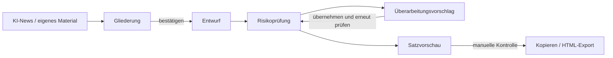

<div align="center">

[English](README.md) | [简体中文](README.zh-CN.md) | [繁體中文](README.zh-TW.md) | [日本語](README.ja.md) | [한국어](README.ko.md) | **Deutsch** | [Français](README.fr.md) | [Español](README.es.md) | [Português](README.pt-BR.md) | [Русский](README.ru.md)

# TrendPublish

Ein lokaler KI-Schreibtisch für Artikel auf WeChat Official Accounts, bei dem der Mensch jeden Schritt in der Hand behält: Material → Gliederung → Entwurf → Risikoprüfung → Überarbeitung → Export.

[](LICENSE)
[](https://deno.com/)
[](https://www.typescriptlang.org/)


</div>

> [!NOTE]
> Die Oberfläche, die Schreib-Prompts und die Prüfregeln sind auf vereinfachtem Chinesisch und richten sich an chinesische Leser von WeChat Official Accounts. Dieses Repository ist ein Fork von [liyown/ai-trend-publish](https://github.com/liyown/ai-trend-publish); die ursprüngliche automatisierte Veröffentlichungspipeline ist weiterhin enthalten (siehe [Upstream-Funktionen](#upstream-funktionen)).

## Funktionen

- **Themen aus KI-News wählen**: Liest bei Bedarf die öffentlichen RSS-Feeds von OpenAI und Hugging Face (5 Minuten Cache), sortiert nach Veröffentlichungszeit, Links und Datum bleiben erhalten. Bis zu 5 Einträge lassen sich als Quellen auswählen.
- **Erst die Gliederung, dann der Entwurf**: Du schreibst die Gliederung selbst oder lässt sie vom Modell entwerfen. Bevor der Artikel erzeugt wird, musst du die Gliederung bestätigen; wer Thema, Material oder Gliederung ändert, setzt die Bestätigung zurück.
- **Unabhängige Risikoprüfung**: Jeder Entwurf, ob generiert oder von Hand geschrieben, lässt sich in sechs Dimensionen prüfen: Plattform, Datenschutz, Fakten, Stil, Lesbarkeit und Rechte. Jeder Befund zitiert den betroffenen Satz wörtlich, macht einen Vorschlag und nennt die Regel-IDs.
- **Überarbeitungsvorschlag**: Erzeugt eine überarbeitete Fassung, die nur die zitierten Sätze anfasst, und listet jede Änderung mit ihrer Regel-ID auf. Du vergleichst und entscheidest, ob du sie übernimmst.
- **Export, fertig für WeChat**: Rendert den Artikel mit der `minimal`-WeChat-Vorlage aus dem Upstream-Projekt. Als Rich Text kopieren oder als HTML / Markdown herunterladen.
- **Standardmäßig lokal und privat**: Der Server lauscht nur auf `127.0.0.1`, lehnt Cross-Origin-Schreibzugriffe ab und durchsucht deine Eingaben nach gängigen Zugangsdaten, Telefonnummern, Ausweisnummern und E-Mail-Adressen, bevor irgendetwas an das Modell geht.
- **Keine stillen Fehler**: Eine abgeschnittene oder nicht abgeschlossene Prüfung gilt nie als bestanden, und dein Entwurf bleibt erhalten, wenn ein Modellaufruf fehlschlägt.


_Demo-Inhalt: Das Prüfergebnis in diesem Screenshot sind Beispieldaten._

## Ablauf



1. **Material**: Quellen aus der News-Liste auswählen und/oder eigene Auszüge und Notizen einfügen.
2. **Gliederung**: Eine erzeugen oder selbst schreiben und dann bestätigen.
3. **Entwurf**: Den Artikel erzeugen und im Editor frei bearbeiten.
4. **Risikoprüfung**: Den aktuellen Entwurf gegen die P- und E-Regeln prüfen (siehe unten).
5. **Überarbeitung**: Einen Überarbeitungsvorschlag erzeugen, vergleichen, übernehmen und erneut prüfen.
6. **Export**: Die Satzvorschau aktualisieren, die manuelle Kontrolle abhaken, dann kopieren oder exportieren. Veröffentlicht wird von Hand im WeChat-Backend.


_Demo-Inhalt: Gliederung und Artikel oben sind ein Beispiel, das für dieses README geschrieben wurde._

## Schnellstart

**Voraussetzungen**: [Deno 2](https://docs.deno.com/runtime/getting_started/installation/) und ein DeepSeek-API-Key.

```sh
git clone https://github.com/TinkCarlos/trendpublish.git
cd trendpublish
deno task simple
```

Dann <http://127.0.0.1:8000> öffnen. Der Task baut die Webseite und startet den lokalen Server.

**Modell einrichten**, beide Wege funktionieren:

- Auf der Seite **模型设置** (Modelleinstellungen) öffnen und den DeepSeek-API-Key sowie den Modellnamen eintragen (Standard: `deepseek-flash`). Die Einstellungen werden mit Dateirechten `600` in `src/temp/simple-model.json` gespeichert; das Verzeichnis wird von git ignoriert.
- Oder beim Start Umgebungsvariablen setzen. Sie werden nur verwendet, wenn `src/temp/simple-model.json` nicht existiert:

  ```sh
  DEEPSEEK_API_KEY=<your-deepseek-api-key> DEEPSEEK_MODEL=deepseek-flash deno task simple
  ```

Das Speichern der Einstellungen ruft das Modell nicht auf. Material und Gliederung gehen nur dann an die DeepSeek-API (`https://api.deepseek.com/v1`), wenn du etwas generierst oder prüfst, und das geht vom Kontingent deines Kontos ab.

## Konfiguration

| Einstellung | Standard | Hinweise |
|---|---|---|
| `SIMPLE_PORT` | `8000` | Port des lokalen Servers, `1024`–`65535`. |
| `SIMPLE_REASONING_EFFORT` | `max` | `max` oder `high`. Gilt für Gliederung, Entwurf, Prüfung und Überarbeitung. Jeder andere Wert stoppt den Server beim Start. Wirksam nach einem Neustart. |
| `DEEPSEEK_API_KEY` / `DEEPSEEK_MODEL` | — / `deepseek-flash` | Fallback, wenn keine Einstellungsdatei existiert. |
| `SIMPLE_DEBUG_ARTICLE_MAX_TOKENS` | nicht gesetzt | **Nur zum Debuggen.** Senkt das Token-Limit für den Entwurf (`64`–`32768`), um den automatischen Retry auszulösen. Der Entwurf schlägt dann fast immer fehl; danach entfernen und neu starten. |

Limits pro Schritt (im Code festgelegt; der Thinking-Modus ist immer aktiv, und Thinking-Tokens zählen zum Ausgabebudget):

| Schritt | Max. Ausgabe-Tokens | Request-Timeout |
|---|---|---|
| Gliederung | 16384 | 600 s |
| Entwurf | 32768 | 600 s |
| Risikoprüfung | 65536 | 600 s |
| Überarbeitungsvorschlag | 32768 | 600 s |

Es läuft immer nur eine Generierung gleichzeitig; eine zweite Anfrage erhält HTTP `409`, bis die erste fertig ist. `GET /api/simple/status` meldet den aktuellen Schritt und Versuch.

## Regeln der Risikoprüfung

Die Regeln liegen in [`src/apps/simple/editorial-rules.ts`](src/apps/simple/editorial-rules.ts) und sind versioniert (`RULE_VERSION`). Eine neue Regelversion macht frühere Prüfungen ungültig.

- **P-Regeln (P1–P11)** beruhen auf öffentlichen Quellen, jeweils verlinkt mit Datum und Verbindlichkeitsstufe: die Betriebs- und Empfehlungsrichtlinien für WeChat Official Accounts, die Bestimmungen zur Kennzeichnung KI-generierter Inhalte, Mitteilungen zur Regulierung von Self-Media und zur Echtheit von Reichweite, die Verwaltungsmaßnahmen für Internetwerbung und das Werbegesetz der VR China. Sie decken Clickbait-Titel, Identitätsanmaßung, KI-Kennzeichnung und Quellenangaben, unbelegte Fakten und veraltete Nachrichten, fachliche Ratschläge, Quellen zu Ereignissen, geschürte Ängste, „Teilen zum Freischalten“-Tricks, nicht gekennzeichnete Werbung, absolute Aussagen und Einkommensversprechen ab.
- **E-Regeln (E1–E7)** sind redaktionelle Erfahrung: Nutzen für die Leser, natürliches Chinesisch ohne Übersetzungston, eine zum Genre passende Struktur, von Vorlagen lernen ohne abzuschreiben, ob der Einstieg auch für Außenstehende verständlich ist, Längen im Text und was die Leser am Ende mitnehmen.
- Sachliche Fehler (falsche Zahlen oder Zuschreibungen, Widersprüche, Rechnungen, die nicht aufgehen) müssen **P4** zitieren.

Die Prüfung sagt keine WeChat-Empfehlungen voraus, bewertet nicht, wie „KI-haft“ ein Text klingt, und garantiert keine Rechtskonformität. Unsichere Fakten sowie Urheberrechts- und Lizenzfragen bleiben einer menschlichen Prüfung überlassen.

## Automatischer Retry und KI-Hinweis

- **Automatischer Retry**: Mit aktivem Thinking verbraucht das Modell gelegentlich sein gesamtes Token-Budget fürs Nachdenken und liefert keinen Text. Endet eine Gliederung oder ein Entwurf mit `finish_reason: length` **und** leerem Inhalt, versucht der Server es genau einmal erneut; die Seite zeigt den zweiten Versuch. Eine abgeschnittene Antwort, die Text enthält, wird stattdessen als Fehler gemeldet und nicht wiederholt.
- **KI-Hinweis, genau einmal**: Ist der Artikel als KI-gestützt markiert, hängt der Export `本文使用 AI 辅助创作。` („Dieser Artikel wurde mit KI-Unterstützung verfasst.“) an. Ähnliche Hinweise, die das Modell in den Text geschrieben hat, werden vorher entfernt, sodass der exportierte Artikel genau einen Hinweis enthält. Beim Veröffentlichen solltest du trotzdem die KI-Inhaltskennzeichnung im WeChat-Backend nutzen.

## Tests

```sh
deno task simple:test
deno check src/apps/simple/server.ts scripts/simple.ts
deno check --config dashboard/deno.json dashboard/src/env.d.ts dashboard/src/simple.tsx
```

## Projektstruktur

```text
.
├── scripts/simple.ts            # builds the page and starts the local workbench
├── src/apps/simple/
│   ├── server.ts                # loopback-only HTTP API (/api/simple/*)
│   ├── workbench.ts             # news, outline, draft, render
│   ├── editorial.ts             # risk review and suggested revision
│   ├── editorial-rules.ts       # P/E rules, sources, RULE_VERSION
│   ├── writing-style.ts         # writing style prompt
│   ├── privacy.ts               # local privacy scan, AI disclosure handling
│   ├── review-contract.ts       # review result types: six categories, severity, rule IDs
│   ├── effort.ts                # SIMPLE_REASONING_EFFORT
│   └── *.test.ts
├── dashboard/
│   ├── simple.html
│   └── src/simple.tsx           # workbench UI
├── src/features/weixin-article/ # upstream WeChat rendering templates and pipeline
└── docs/                        # upstream and project documentation
```

## Upstream-Funktionen

Die komplette automatisierte Pipeline aus dem Upstream-Projekt (zeitgesteuerte Themenauswahl, Dashboard, Veröffentlichung von WeChat-Entwürfen, Deployment mit Docker und Cloudflare) ist weiterhin in diesem Repository enthalten und wird mit `deno task dev` gestartet. Details unter [`docs/`](docs/). Nicht gleichzeitig mit der Arbeitsoberfläche auf Port 8000 betreiben.

## Danksagung

Dieses Projekt basiert auf [liyown/ai-trend-publish](https://github.com/liyown/ai-trend-publish) von Yaowen Liu und verwendet dessen RSS-Provider, den OpenAI-kompatiblen Modell-Client und die `minimal`-WeChat-Vorlage weiter. Vielen Dank an den Upstream-Autor und alle Mitwirkenden.

## Lizenz

[MIT](LICENSE). Der ursprüngliche Copyright-Vermerk des Upstream-Projekts bleibt erhalten.

## Mitwirken

Issues und Pull Requests sind willkommen. Pull Requests werden vom Maintainer geprüft und gemergt. Bitte vor dem Einreichen `deno task simple:test` ausführen und niemals API-Keys oder personenbezogene Daten in Issues, Commits oder Test-Fixtures aufnehmen.
