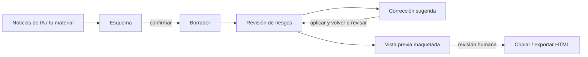

<div align="center">

[English](README.md) | [简体中文](README.zh-CN.md) | [繁體中文](README.zh-TW.md) | [日本語](README.ja.md) | [한국어](README.ko.md) | [Deutsch](README.de.md) | [Français](README.fr.md) | **Español** | [Português](README.pt-BR.md) | [Русский](README.ru.md)

# TrendPublish

Un escritorio de redacción con IA, local y con supervisión humana, para artículos de cuentas oficiales de WeChat: material → esquema → borrador → revisión de riesgos → corrección → exportación.

[](LICENSE)
[](https://deno.com/)
[](https://www.typescriptlang.org/)


</div>

> [!NOTE]
> La interfaz, los prompts de redacción y las reglas de revisión están en chino simplificado y están pensados para lectores chinos de cuentas oficiales de WeChat. Este repositorio es un fork de [liyown/ai-trend-publish](https://github.com/liyown/ai-trend-publish); el pipeline original de publicación automatizada sigue incluido (consulta [Funciones del proyecto original](#funciones-del-proyecto-original)).

## Características

- **Elige un tema a partir de noticias de IA**: lee bajo demanda los feeds RSS públicos de OpenAI y Hugging Face (con 5 minutos de caché), ordenados por fecha de publicación y conservando enlaces y fechas. Puedes seleccionar hasta 5 elementos como fuentes.
- **Primero el esquema, luego el borrador**: escribe el esquema tú mismo o deja que el modelo lo proponga. Tienes que confirmar el esquema antes de generar el artículo; si editas el tema, el material o el esquema, la confirmación se reinicia.
- **Revisión de riesgos independiente**: cualquier borrador, generado o escrito a mano, se puede revisar en seis dimensiones: plataforma, privacidad, hechos, estilo, legibilidad y derechos. Cada problema cita la frase exacta, ofrece una sugerencia e indica los ID de regla.
- **Corrección sugerida**: genera una versión corregida que solo toca las frases citadas y enumera cada cambio con su ID de regla. Tú comparas y decides si la aplicas.
- **Exportación lista para WeChat**: maqueta el artículo con la plantilla de WeChat `minimal` del proyecto original. Cópialo como texto enriquecido o descárgalo en HTML / Markdown.
- **Local y privado por defecto**: el servidor solo escucha en `127.0.0.1`, rechaza escrituras de origen cruzado y, antes de enviar nada al modelo, analiza tu entrada en busca de credenciales comunes, números de teléfono, números de documento de identidad y direcciones de correo electrónico.
- **Sin fallos silenciosos**: una revisión truncada o que no terminó nunca se da por aprobada, y tu borrador se conserva si falla una llamada al modelo.


_Contenido de demostración: el resultado de la revisión en esta captura son datos de ejemplo._

## Flujo de trabajo



1. **Material**: elige fuentes de la lista de noticias y/o pega tus propios fragmentos y notas.
2. **Esquema**: genera uno o escríbelo, y luego confírmalo.
3. **Borrador**: genera el artículo y edítalo libremente en el editor.
4. **Revisión de riesgos**: comprueba el borrador actual con las reglas P y E (ver más abajo).
5. **Corrección**: genera una corrección sugerida, compara, aplícala y vuelve a revisar.
6. **Exportación**: actualiza la vista previa maquetada, marca la comprobación manual y luego copia o exporta. La publicación se hace a mano desde el panel de administración de WeChat.


_Contenido de demostración: el esquema y el artículo de arriba son un ejemplo escrito para este README._

## Inicio rápido

**Requisitos**: [Deno 2](https://docs.deno.com/runtime/getting_started/installation/) y una clave de API de DeepSeek.

```sh
git clone https://github.com/TinkCarlos/trendpublish.git
cd trendpublish
deno task simple
```

Después abre <http://127.0.0.1:8000>. La tarea compila la página web e inicia el servidor local.

**Configuración del modelo**, de cualquiera de estas dos formas:

- En la página, abre **模型设置** (Configuración del modelo) e introduce tu clave de API de DeepSeek y el nombre del modelo (por defecto, `deepseek-flash`). La configuración se guarda en `src/temp/simple-model.json` con permisos `600`; git ignora este directorio.
- O pasa variables de entorno al arrancar. Solo se usan si `src/temp/simple-model.json` no existe:

  ```sh
  DEEPSEEK_API_KEY=<your-deepseek-api-key> DEEPSEEK_MODEL=deepseek-flash deno task simple
  ```

Guardar la configuración no llama al modelo. Tu material y tu esquema se envían a la API de DeepSeek (`https://api.deepseek.com/v1`) solo cuando generas o revisas, y eso consume la cuota de tu cuenta.

## Configuración

| Ajuste | Valor por defecto | Notas |
|---|---|---|
| `SIMPLE_PORT` | `8000` | Puerto del servidor local, `1024`–`65535`. |
| `SIMPLE_REASONING_EFFORT` | `max` | `max` o `high`. Se aplica al esquema, el borrador, la revisión y la corrección. Cualquier otro valor detiene el servidor al arrancar. Reinicia para aplicar el cambio. |
| `DEEPSEEK_API_KEY` / `DEEPSEEK_MODEL` | — / `deepseek-flash` | Valores de respaldo cuando no existe archivo de configuración. |
| `SIMPLE_DEBUG_ARTICLE_MAX_TOKENS` | sin definir | **Solo para depuración.** Reduce el límite de tokens del borrador (`64`–`32768`) para provocar el reintento automático. El borrador fallará casi siempre; quítalo y reinicia al terminar. |

Límites por paso (definidos en el código; el modo de razonamiento siempre está activado y los tokens de razonamiento comparten el presupuesto de salida):

| Paso | Máx. tokens de salida | Tiempo de espera de la solicitud |
|---|---|---|
| Esquema | 16384 | 600 s |
| Borrador | 32768 | 600 s |
| Revisión de riesgos | 65536 | 600 s |
| Corrección sugerida | 32768 | 600 s |

Solo se ejecuta una generación a la vez; una segunda solicitud recibe HTTP `409` hasta que termina la primera. `GET /api/simple/status` informa del paso y el intento actuales.

## Reglas de la revisión de riesgos

Las reglas están en [`src/apps/simple/editorial-rules.ts`](src/apps/simple/editorial-rules.ts) y tienen versión (`RULE_VERSION`). Cambiar la versión de las reglas invalida las revisiones anteriores.

- **Las reglas P (P1–P11)** se basan en fuentes públicas, cada una enlazada con su fecha y su nivel de autoridad: las normas de operación y recomendación de las cuentas oficiales de WeChat, las medidas de etiquetado de contenido generado por IA, los avisos sobre la regulación de los automedios y la autenticidad del tráfico, las Medidas de Publicidad en Internet y la Ley de Publicidad de la República Popular China. Cubren títulos clickbait, suplantación de identidad, etiquetado de IA y atribución, hechos sin respaldo y noticias desactualizadas, consejos profesionales, fuentes de los hechos, ansiedad fabricada, trucos de «comparte para desbloquear», publicidad no declarada, afirmaciones absolutas y promesas de ingresos garantizados.
- **Las reglas E (E1–E7)** son experiencia editorial: valor para el lector, un chino natural sin sabor a traducción, una estructura acorde al género, aprender de los ejemplos sin copiarlos, si el arranque se entiende sin contexto previo, los tramos planos y qué se lleva el lector al final.
- Los errores factuales (cifras o atribuciones incorrectas, contradicciones, cuentas que no cuadran) deben citar **P4**.

La revisión no predice si WeChat recomendará el artículo, no puntúa cuánto «suena a IA» un texto y no garantiza el cumplimiento normativo. Los hechos dudosos y las cuestiones de derechos de autor o licencias quedan para que los verifique una persona.

## Reintento automático y aviso de IA

- **Reintento automático**: con el razonamiento activado, el modelo a veces gasta todo su presupuesto de tokens en razonar y no devuelve texto. Si un esquema o un borrador se detiene con `finish_reason: length` **y** contenido vacío, el servidor reintenta exactamente una vez; la página muestra el segundo intento. Una respuesta truncada que sí contiene texto se notifica como error en lugar de reintentarse.
- **Aviso de IA, una sola vez**: cuando el artículo está marcado como asistido por IA, la exportación añade `本文使用 AI 辅助创作。` («Este artículo se redactó con ayuda de IA.»). Cualquier aviso parecido que el modelo haya escrito en el cuerpo se elimina antes, de modo que el artículo exportado lleva exactamente un aviso. Aun así, al publicar conviene usar la declaración de contenido de IA del panel de administración de WeChat.

## Pruebas

```sh
deno task simple:test
deno check src/apps/simple/server.ts scripts/simple.ts
deno check --config dashboard/deno.json dashboard/src/env.d.ts dashboard/src/simple.tsx
```

## Estructura del proyecto

```text
.
├── scripts/simple.ts            # builds the page and starts the local workbench
├── src/apps/simple/
│   ├── server.ts                # loopback-only HTTP API (/api/simple/*)
│   ├── workbench.ts             # news, outline, draft, render
│   ├── editorial.ts             # risk review and suggested revision
│   ├── editorial-rules.ts       # P/E rules, sources, RULE_VERSION
│   ├── writing-style.ts         # writing style prompt
│   ├── privacy.ts               # local privacy scan, AI disclosure handling
│   ├── review-contract.ts       # review result types: six categories, severity, rule IDs
│   ├── effort.ts                # SIMPLE_REASONING_EFFORT
│   └── *.test.ts
├── dashboard/
│   ├── simple.html
│   └── src/simple.tsx           # workbench UI
├── src/features/weixin-article/ # upstream WeChat rendering templates and pipeline
└── docs/                        # upstream and project documentation
```

## Funciones del proyecto original

El pipeline automatizado completo del proyecto original (selección programada de temas, Dashboard, publicación de borradores en WeChat, despliegue con Docker y Cloudflare) sigue en este repositorio y se inicia con `deno task dev`. Consulta [`docs/`](docs/) para más detalles. No lo ejecutes en el puerto 8000 al mismo tiempo que el espacio de trabajo.

## Agradecimientos

Este proyecto se basa en [liyown/ai-trend-publish](https://github.com/liyown/ai-trend-publish) de Yaowen Liu y reutiliza su proveedor de RSS, su cliente de modelos compatible con OpenAI y su plantilla de WeChat `minimal`. Muchas gracias al autor original y a sus colaboradores.

## Licencia

[MIT](LICENSE). Se conserva el aviso de copyright original del proyecto del que deriva.

## Contribuir

Las issues y las pull requests son bienvenidas. El mantenedor revisa y fusiona las pull requests. Ejecuta `deno task simple:test` antes de enviar y nunca incluyas claves de API ni datos personales en issues, commits o fixtures de prueba.
