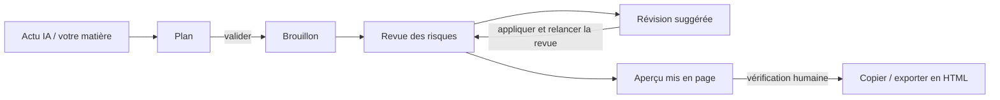

<div align="center">

[English](README.md) | [简体中文](README.zh-CN.md) | [繁體中文](README.zh-TW.md) | [日本語](README.ja.md) | [한국어](README.ko.md) | [Deutsch](README.de.md) | **Français** | [Español](README.es.md) | [Português](README.pt-BR.md) | [Русский](README.ru.md)

# TrendPublish

Un atelier d'écriture IA local, avec un humain dans la boucle, pour les articles de comptes officiels WeChat : matière → plan → brouillon → revue des risques → révision → export.

[](LICENSE)
[](https://deno.com/)
[](https://www.typescriptlang.org/)


</div>

> [!NOTE]
> L'interface de l'atelier, les prompts d'écriture et les règles de revue sont en chinois simplifié et s'adressent aux lecteurs chinois des comptes officiels WeChat. Ce dépôt est un fork de [liyown/ai-trend-publish](https://github.com/liyown/ai-trend-publish) ; le pipeline de publication automatisée d'origine est toujours inclus (voir [Fonctionnalités du projet amont](#fonctionnalités-du-projet-amont)).

## Fonctionnalités

- **Trouver un sujet dans l'actu IA** : lit à la demande les flux RSS publics d'OpenAI et de Hugging Face (cache de 5 minutes), triés par date de publication, liens et dates conservés. Vous pouvez retenir jusqu'à 5 éléments comme sources.
- **Le plan d'abord, le brouillon ensuite** : rédigez le plan vous-même ou laissez le modèle le proposer. Le plan doit être validé avant la génération de l'article ; modifier le sujet, la matière ou le plan annule la validation.
- **Revue des risques indépendante** : chaque brouillon, généré ou écrit à la main, peut être relu selon six axes : plateforme, vie privée, faits, style, lisibilité et droits. Chaque problème cite la phrase exacte, propose une correction et renvoie aux identifiants de règles.
- **Révision suggérée** : génère une version révisée qui ne touche qu'aux phrases citées et liste chaque modification avec son identifiant de règle. Vous comparez et décidez de l'appliquer ou non.
- **Export prêt pour WeChat** : met en page l'article avec le modèle WeChat `minimal` du projet amont. Copiez-le en texte enrichi ou téléchargez-le en HTML / Markdown.
- **Local et privé par défaut** : le serveur n'écoute que sur `127.0.0.1`, refuse les écritures cross-origin et analyse votre saisie à la recherche d'identifiants courants, de numéros de téléphone, de numéros de pièce d'identité et d'adresses e-mail avant tout envoi au modèle.
- **Aucun échec silencieux** : une revue tronquée ou inachevée n'est jamais considérée comme réussie, et votre brouillon est conservé si un appel au modèle échoue.


_Contenu de démonstration : le résultat de revue sur cette capture est un jeu de données d'exemple._

## Déroulement



1. **Matière** : choisissez des sources dans la liste d'actualités et/ou collez vos propres extraits et notes.
2. **Plan** : générez-en un ou écrivez-le, puis validez-le.
3. **Brouillon** : générez l'article et modifiez-le librement dans l'éditeur.
4. **Revue des risques** : vérifiez le brouillon courant au regard des règles P et E (voir plus bas).
5. **Révision** : générez une révision suggérée, comparez, appliquez, puis relancez la revue.
6. **Export** : mettez à jour l'aperçu, cochez la vérification manuelle, puis copiez ou exportez. La publication se fait à la main depuis le back-office WeChat.


_Contenu de démonstration : le plan et l'article ci-dessus sont un exemple rédigé pour ce README._

## Démarrage rapide

**Prérequis** : [Deno 2](https://docs.deno.com/runtime/getting_started/installation/) et une clé API DeepSeek.

```sh
git clone https://github.com/TinkCarlos/trendpublish.git
cd trendpublish
deno task simple
```

Ouvrez ensuite <http://127.0.0.1:8000>. La tâche construit la page web et démarre le serveur local.

**Configuration du modèle**, au choix :

- Dans la page, ouvrez **模型设置** (Paramètres du modèle) et saisissez votre clé API DeepSeek et le nom du modèle (par défaut `deepseek-flash`). Les paramètres sont enregistrés dans `src/temp/simple-model.json` avec les permissions `600` ; ce répertoire est ignoré par git.
- Ou fournissez des variables d'environnement au démarrage. Elles ne sont utilisées que si `src/temp/simple-model.json` n'existe pas :

  ```sh
  DEEPSEEK_API_KEY=<your-deepseek-api-key> DEEPSEEK_MODEL=deepseek-flash deno task simple
  ```

Enregistrer les paramètres n'appelle pas le modèle. Votre matière et votre plan ne sont envoyés à l'API DeepSeek (`https://api.deepseek.com/v1`) que lorsque vous générez ou lancez une revue, ce qui consomme le quota de votre compte.

## Configuration

| Paramètre | Défaut | Remarques |
|---|---|---|
| `SIMPLE_PORT` | `8000` | Port du serveur local, `1024`–`65535`. |
| `SIMPLE_REASONING_EFFORT` | `max` | `max` ou `high`. S'applique au plan, au brouillon, à la revue et à la révision. Toute autre valeur arrête le serveur au démarrage. Redémarrez pour appliquer. |
| `DEEPSEEK_API_KEY` / `DEEPSEEK_MODEL` | — / `deepseek-flash` | Valeurs de repli lorsqu'aucun fichier de paramètres n'existe. |
| `SIMPLE_DEBUG_ARTICLE_MAX_TOKENS` | non défini | **Débogage uniquement.** Abaisse la limite de tokens du brouillon (`64`–`32768`) pour déclencher la relance automatique. Le brouillon échouera presque à coup sûr ; supprimez la variable et redémarrez ensuite. |

Limites par étape (fixées dans le code ; le mode réflexion est toujours activé et les tokens de réflexion partagent le budget de sortie) :

| Étape | Tokens de sortie max. | Délai d'expiration de la requête |
|---|---|---|
| Plan | 16384 | 600 s |
| Brouillon | 32768 | 600 s |
| Revue des risques | 65536 | 600 s |
| Révision suggérée | 32768 | 600 s |

Une seule génération tourne à la fois ; une deuxième requête reçoit HTTP `409` tant que la première n'est pas terminée. `GET /api/simple/status` indique l'étape et la tentative en cours.

## Règles de la revue des risques

Les règles se trouvent dans [`src/apps/simple/editorial-rules.ts`](src/apps/simple/editorial-rules.ts) et sont versionnées (`RULE_VERSION`). Changer de version de règles invalide les revues précédentes.

- **Les règles P (P1–P11)** s'appuient sur des sources publiques, chacune liée avec sa date et son niveau d'autorité : les normes d'exploitation et de recommandation des comptes officiels WeChat, les mesures d'étiquetage des contenus générés par IA, les avis sur l'encadrement des médias autoproduits et l'authenticité du trafic, les Mesures sur la publicité sur Internet et la Loi sur la publicité de la RPC. Elles couvrent les titres racoleurs, l'usurpation d'identité, l'étiquetage IA et l'attribution, les faits non étayés et les actualités périmées, les conseils professionnels, le sourçage des événements, l'anxiété fabriquée, les astuces du type « partagez pour débloquer », la publicité non signalée, les affirmations absolues et les promesses de revenus garantis.
- **Les règles E (E1–E7)** relèvent de l'expérience éditoriale : la valeur pour le lecteur, un chinois naturel sans tournures de traduction, une structure adaptée au genre, s'inspirer d'exemples sans les copier, une introduction compréhensible pour un non-initié, les passages qui s'essoufflent et ce que le lecteur retient à la fin.
- Les erreurs factuelles (chiffres ou attributions erronés, contradictions, calculs qui ne tombent pas juste) doivent citer **P4**.

La revue ne prédit pas la recommandation par WeChat, ne note pas le côté « IA » d'un texte et ne garantit pas la conformité. Les faits incertains et les questions de droit d'auteur ou de licence sont laissés à la vérification humaine.

## Relance automatique et mention IA

- **Relance automatique** : avec la réflexion activée, il arrive que le modèle consacre tout son budget de tokens au raisonnement et ne renvoie aucun texte. Si un plan ou un brouillon s'arrête avec `finish_reason: length` **et** un contenu vide, le serveur relance exactement une fois ; la page affiche la deuxième tentative. Une réponse tronquée qui contient du texte est signalée comme une erreur au lieu d'être relancée.
- **Mention IA, une seule fois** : lorsque l'article est marqué comme rédigé avec l'aide de l'IA, l'export ajoute `本文使用 AI 辅助创作。` (« Cet article a été rédigé avec l'aide de l'IA. »). Toute mention similaire écrite par le modèle dans le corps du texte est d'abord supprimée, si bien que l'article exporté contient exactement une mention. Lors de la publication, utilisez quand même la déclaration de contenu IA du back-office WeChat.

## Tests

```sh
deno task simple:test
deno check src/apps/simple/server.ts scripts/simple.ts
deno check --config dashboard/deno.json dashboard/src/env.d.ts dashboard/src/simple.tsx
```

## Structure du projet

```text
.
├── scripts/simple.ts            # builds the page and starts the local workbench
├── src/apps/simple/
│   ├── server.ts                # loopback-only HTTP API (/api/simple/*)
│   ├── workbench.ts             # news, outline, draft, render
│   ├── editorial.ts             # risk review and suggested revision
│   ├── editorial-rules.ts       # P/E rules, sources, RULE_VERSION
│   ├── writing-style.ts         # writing style prompt
│   ├── privacy.ts               # local privacy scan, AI disclosure handling
│   ├── review-contract.ts       # review result types: six categories, severity, rule IDs
│   ├── effort.ts                # SIMPLE_REASONING_EFFORT
│   └── *.test.ts
├── dashboard/
│   ├── simple.html
│   └── src/simple.tsx           # workbench UI
├── src/features/weixin-article/ # upstream WeChat rendering templates and pipeline
└── docs/                        # upstream and project documentation
```

## Fonctionnalités du projet amont

Le pipeline automatisé complet du projet amont (sélection de sujets planifiée, Dashboard, publication de brouillons WeChat, déploiement Docker et Cloudflare) est toujours présent dans ce dépôt et se lance avec `deno task dev`. Voir [`docs/`](docs/) pour plus de détails. Ne le faites pas tourner sur le port 8000 en même temps que l'atelier.

## Remerciements

Ce projet s'appuie sur [liyown/ai-trend-publish](https://github.com/liyown/ai-trend-publish) de Yaowen Liu et en réutilise le fournisseur RSS, le client de modèle compatible OpenAI et le modèle WeChat `minimal`. Un grand merci à l'auteur du projet amont et à ses contributeurs.

## Licence

[MIT](LICENSE). La mention de copyright d'origine du projet amont est conservée.

## Contribuer

Les issues et les pull requests sont les bienvenues. Les pull requests sont relues et fusionnées par le mainteneur. Lancez `deno task simple:test` avant de soumettre, et n'incluez jamais de clés API ni de données personnelles dans les issues, les commits ou les fixtures de test.
