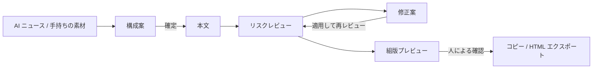

<div align="center">

[English](README.md) | [简体中文](README.zh-CN.md) | [繁體中文](README.zh-TW.md) | **日本語** | [한국어](README.ko.md) | [Deutsch](README.de.md) | [Français](README.fr.md) | [Español](README.es.md) | [Português](README.pt-BR.md) | [Русский](README.ru.md)

# TrendPublish

WeChat 公式アカウント向けの記事を、人の判断を挟みながら書くためのローカル AI ライティングデスクです：素材 → 構成案 → 本文 → リスクレビュー → 修正 → エクスポート。

[](LICENSE)
[](https://deno.com/)
[](https://www.typescriptlang.org/)


</div>

> [!NOTE]
> ワークベンチの UI、執筆用プロンプト、レビュールールはすべて簡体字中国語で、中国の WeChat 公式アカウント読者を想定しています。このリポジトリは [liyown/ai-trend-publish](https://github.com/liyown/ai-trend-publish) のフォークで、元の自動投稿パイプラインも引き続き含まれています（[アップストリームの機能](#アップストリームの機能)を参照）。

## 機能

- **AI ニュースからテーマを選ぶ**：OpenAI と Hugging Face の公開 RSS フィードを必要なときに読み込み（5 分間キャッシュ）、公開日時順に並べます。リンクと日付はそのまま残ります。素材として最大 5 件まで選べます。
- **構成案が先、本文はその後**：構成案は自分で書いても、モデルに下書きさせても構いません。本文を生成する前に構成案の確定が必要で、テーマ・素材・構成案を編集すると確定はリセットされます。
- **独立したリスクレビュー**：生成した本文も手書きの本文も、プラットフォーム、プライバシー、事実、文体、読みやすさ、権利の 6 つの観点でレビューできます。指摘ごとに該当する一文を引用し、改善案とルール ID を示します。
- **修正案の提示**：引用された文だけに手を入れた修正版を生成し、すべての変更をルール ID 付きで一覧にします。見比べたうえで適用するかどうかを決めます。
- **WeChat にそのまま使えるエクスポート**：アップストリームの `minimal` WeChat テンプレートで整形します。リッチテキストとしてコピーするか、HTML / Markdown でダウンロードできます。
- **ローカル動作・プライバシー重視が標準**：サーバーは `127.0.0.1` でのみ待ち受け、クロスオリジンの書き込みを拒否します。モデルに何かを送る前に、入力内容に一般的な認証情報、電話番号、身分証番号、メールアドレスが含まれていないかをスキャンします。
- **黙って失敗しない**：途中で切れた、あるいは完了しなかったレビューを合格扱いにすることはありません。モデル呼び出しが失敗しても本文は保持されます。


_デモ用コンテンツ：このスクリーンショットのレビュー結果はサンプルデータです。_

## ワークフロー



1. **素材**：ニュース一覧からソースを選ぶか、自分の抜粋やメモを貼り付けます（併用も可）。
2. **構成案**：生成するか自分で書いて、確定します。
3. **本文**：記事を生成し、エディターで自由に編集します。
4. **リスクレビュー**：現在の本文を P ルールと E ルールでチェックします（後述）。
5. **修正**：修正案を生成し、見比べて適用し、もう一度レビューします。
6. **エクスポート**：組版プレビューを更新し、手動チェックにチェックを入れてから、コピーまたはエクスポートします。公開は WeChat の管理画面から手動で行います。


_デモ用コンテンツ：上の構成案と記事は、この README のために用意したサンプルです。_

## クイックスタート

**必要なもの**：[Deno 2](https://docs.deno.com/runtime/getting_started/installation/) と DeepSeek の API キー。

```sh
git clone https://github.com/TinkCarlos/ai-writing-desk.git
cd ai-writing-desk
deno task simple
```

あとは <http://127.0.0.1:8000> を開くだけです。このタスクが Web ページをビルドし、ローカルサーバーを起動します。

**モデルの設定**は、次のどちらでも構いません。

- ページで **模型设置**（モデル設定）を開き、DeepSeek の API キーとモデル名（デフォルトは `deepseek-flash`）を入力します。設定はファイルモード `600` で `src/temp/simple-model.json` に保存されます。このディレクトリは git の管理対象外です。
- または、起動時に環境変数で渡します。これは `src/temp/simple-model.json` が存在しない場合にのみ使われます。

  ```sh
  DEEPSEEK_API_KEY=<your-deepseek-api-key> DEEPSEEK_MODEL=deepseek-flash deno task simple
  ```

設定を保存しただけではモデルは呼び出されません。素材と構成案が DeepSeek API（`https://api.deepseek.com/v1`）に送られるのは生成またはレビューを実行したときだけで、その分はあなたのアカウントの利用枠から消費されます。

## 設定

| 設定 | デフォルト | 説明 |
|---|---|---|
| `SIMPLE_PORT` | `8000` | ローカルサーバーのポート（`1024`–`65535`）。 |
| `SIMPLE_REASONING_EFFORT` | `max` | `max` または `high`。構成案、本文、レビュー、修正に適用されます。それ以外の値を指定すると起動時にサーバーが停止します。反映には再起動が必要です。 |
| `DEEPSEEK_API_KEY` / `DEEPSEEK_MODEL` | — / `deepseek-flash` | 設定ファイルがない場合のフォールバック。 |
| `SIMPLE_DEBUG_ARTICLE_MAX_TOKENS` | 未設定 | **デバッグ専用。** 本文の token 上限を下げて（`64`–`32768`）自動リトライを試すためのものです。本文の生成はほぼ確実に失敗するので、終わったら削除して再起動してください。 |

ステップごとの上限（コードで設定。思考モードは常にオンで、思考に使う token も出力の予算に含まれます）：

| ステップ | 最大出力 token | リクエストのタイムアウト |
|---|---|---|
| 構成案 | 16,384 | 600 秒 |
| 本文 | 32,768 | 600 秒 |
| リスクレビュー | 65,536 | 600 秒 |
| 修正案 | 32,768 | 600 秒 |

生成は同時に 1 つしか実行されません。最初の処理が終わるまで、2 つ目のリクエストには HTTP `409` が返ります。`GET /api/simple/status` で現在のステップと試行回数を確認できます。

## リスクレビューのルール

ルールは [`src/apps/simple/editorial-rules.ts`](src/apps/simple/editorial-rules.ts) にあり、バージョン管理されています（`RULE_VERSION`）。ルールのバージョンを変えると、それ以前のレビュー結果は無効になります。

- **P ルール（P1–P11）** は公開情報に基づいており、それぞれに日付と効力のレベルを添えてリンクしています。根拠は、WeChat 公式アカウントの運営規範と推薦規範、AI 生成コンテンツの表示に関する弁法、自媒体の管理とトラフィックの真正性に関する通知、インターネット広告管理弁法、中華人民共和国広告法です。釣りタイトル、なりすまし、AI 表示と出典の明記、根拠のない事実や古いニュース、専門的な助言、出来事の情報源、不安をあおる表現、シェアで続きが読める仕掛け、広告であることの不表示、断定的な表現、収益の保証をカバーします。
- **E ルール（E1–E7）** は編集の経験則です。読者にとっての価値、翻訳調でない自然な中国語、ジャンルに合った構成、お手本から学びつつ丸写ししないこと、冒頭が予備知識のない人にも通じるか、単調な箇所、そして読者が何を持ち帰れるかを見ます。
- 事実の誤り（数字や帰属の誤り、矛盾、計算が合わないもの）には必ず **P4** を引用します。

レビューは WeChat での推薦を予測するものではなく、「AI っぽさ」を採点することも、コンプライアンスを保証することもありません。不確かな事実や、著作権・ライセンスに関する問題は人が確認するよう残しておきます。

## 自動リトライと AI 利用の表示

- **自動リトライ**：思考モードが有効だと、モデルがまれに token の予算をすべて推論に使い切り、テキストを返さないことがあります。構成案または本文が `finish_reason: length` で止まり、**かつ**内容が空の場合、サーバーは 1 回だけリトライし、ページには 2 回目の結果が表示されます。途中で切れていてもテキストが含まれている応答は、リトライせずにエラーとして報告します。
- **AI 利用の表示は 1 回だけ**：記事が AI 支援ありとマークされている場合、エクスポート時に `本文使用 AI 辅助创作。`（「この記事は AI の支援を受けて作成されました。」）を末尾に追加します。モデルが本文中に書いた同様の記述は先に削除されるので、エクスポートされた記事には表示がちょうど 1 つだけ入ります。公開する際は、引き続き WeChat の管理画面にある AI コンテンツの申告機能も使ってください。

## テスト

```sh
deno task simple:test
deno check src/apps/simple/server.ts scripts/simple.ts
deno check --config dashboard/deno.json dashboard/src/env.d.ts dashboard/src/simple.tsx
```

## プロジェクト構成

```text
.
├── scripts/simple.ts            # builds the page and starts the local workbench
├── src/apps/simple/
│   ├── server.ts                # loopback-only HTTP API (/api/simple/*)
│   ├── workbench.ts             # news, outline, draft, render
│   ├── editorial.ts             # risk review and suggested revision
│   ├── editorial-rules.ts       # P/E rules, sources, RULE_VERSION
│   ├── writing-style.ts         # writing style prompt
│   ├── privacy.ts               # local privacy scan, AI disclosure handling
│   ├── review-contract.ts       # review result types: six categories, severity, rule IDs
│   ├── effort.ts                # SIMPLE_REASONING_EFFORT
│   └── *.test.ts
├── dashboard/
│   ├── simple.html
│   └── src/simple.tsx           # workbench UI
├── src/features/weixin-article/ # upstream WeChat rendering templates and pipeline
└── docs/                        # upstream and project documentation
```

## アップストリームの機能

アップストリームの完全な自動パイプライン（定期的なテーマ選定、Dashboard、WeChat への下書き投稿、Docker と Cloudflare へのデプロイ）もこのリポジトリに残っており、`deno task dev` で起動できます。詳しくは [`docs/`](docs/) を参照してください。ワークベンチと同時にポート 8000 で動かさないでください。

## 謝辞

このプロジェクトは Yaowen Liu 氏の [liyown/ai-trend-publish](https://github.com/liyown/ai-trend-publish) をベースにしており、その RSS プロバイダー、OpenAI 互換のモデルクライアント、`minimal` WeChat テンプレートを再利用しています。アップストリームの作者とコントリビューターの皆さんに深く感謝します。

## ライセンス

[MIT](LICENSE)。アップストリームプロジェクトの元の著作権表示はそのまま残しています。

## コントリビューション

Issue や Pull Request を歓迎します。Pull Request はメンテナーがレビューしてマージします。送る前に `deno task simple:test` を実行してください。また、Issue、コミット、テスト用データに API キーや個人情報を含めないでください。
