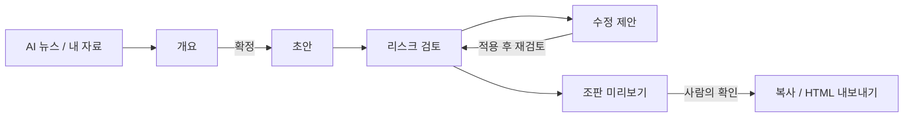

<div align="center">

[English](README.md) | [简体中文](README.zh-CN.md) | [繁體中文](README.zh-TW.md) | [日本語](README.ja.md) | **한국어** | [Deutsch](README.de.md) | [Français](README.fr.md) | [Español](README.es.md) | [Português](README.pt-BR.md) | [Русский](README.ru.md)

# TrendPublish

사람이 직접 검토하며 위챗 공식 계정 글을 쓰는 로컬 AI 글쓰기 도구입니다: 자료 → 개요 → 초안 → 리스크 검토 → 수정 → 내보내기.

[](LICENSE)
[](https://deno.com/)
[](https://www.typescriptlang.org/)


</div>

> [!NOTE]
> 작업 화면 UI, 글쓰기 프롬프트, 검토 규칙은 모두 중국어 간체로 되어 있으며 중국의 위챗 공식 계정 독자를 대상으로 합니다. 이 저장소는 [liyown/ai-trend-publish](https://github.com/liyown/ai-trend-publish)의 포크이며, 원래의 자동 발행 파이프라인도 그대로 포함되어 있습니다([업스트림 기능](#업스트림-기능) 참고).

## 기능

- **AI 뉴스에서 주제 고르기**: OpenAI와 Hugging Face의 공개 RSS 피드를 필요할 때 읽어 오고(5분간 캐시), 게시 시각 순으로 정렬하며 링크와 날짜를 그대로 유지합니다. 최대 5개 항목을 자료로 선택할 수 있습니다.
- **개요 먼저, 초안은 그다음**: 개요는 직접 쓰거나 모델에게 초안을 맡길 수 있습니다. 글을 생성하기 전에 반드시 개요를 확정해야 하며, 주제·자료·개요를 수정하면 확정이 초기화됩니다.
- **독립적인 리스크 검토**: 생성한 초안이든 직접 쓴 초안이든 플랫폼, 개인정보, 사실, 문체, 가독성, 권리의 6가지 관점에서 검토할 수 있습니다. 문제마다 해당 문장을 그대로 인용하고, 제안과 규칙 ID를 함께 보여 줍니다.
- **수정 제안**: 인용된 문장만 고친 수정본을 생성하고, 모든 변경 사항을 규칙 ID와 함께 나열합니다. 비교해 본 뒤 적용할지 직접 결정합니다.
- **위챗에 바로 쓸 수 있는 내보내기**: 업스트림의 `minimal` 위챗 템플릿으로 글을 렌더링합니다. 서식 있는 텍스트로 복사하거나 HTML / Markdown으로 내려받을 수 있습니다.
- **기본은 로컬, 기본은 비공개**: 서버는 `127.0.0.1`에서만 수신하고 교차 출처 쓰기 요청을 거부합니다. 모델에 무언가를 보내기 전에 입력 내용에 흔한 자격 증명, 전화번호, 신분증 번호, 이메일 주소가 있는지 검사합니다.
- **조용히 실패하지 않음**: 잘렸거나 끝나지 않은 검토는 절대 통과로 처리하지 않으며, 모델 호출이 실패해도 초안은 그대로 남습니다.


_데모 콘텐츠: 이 스크린샷의 검토 결과는 샘플 데이터입니다._

## 작업 흐름



1. **자료**: 뉴스 목록에서 출처를 고르거나, 직접 모은 발췌와 메모를 붙여 넣습니다. 둘 다 써도 됩니다.
2. **개요**: 생성하거나 직접 쓴 뒤 확정합니다.
3. **초안**: 글을 생성하고 편집기에서 자유롭게 고칩니다.
4. **리스크 검토**: 현재 초안을 P 규칙과 E 규칙으로 검사합니다(아래 참고).
5. **수정**: 수정 제안을 생성해 비교하고, 적용한 다음 다시 검토합니다.
6. **내보내기**: 조판 미리보기를 갱신하고 수동 확인에 체크한 뒤 복사하거나 내보냅니다. 발행은 위챗 관리자 화면에서 직접 합니다.


_데모 콘텐츠: 위의 개요와 글은 이 README를 위해 작성한 샘플입니다._

## 빠른 시작

**요구 사항**: [Deno 2](https://docs.deno.com/runtime/getting_started/installation/)와 DeepSeek API 키.

```sh
git clone https://github.com/TinkCarlos/trendpublish.git
cd trendpublish
deno task simple
```

그런 다음 <http://127.0.0.1:8000>을 엽니다. 이 태스크가 웹 페이지를 빌드하고 로컬 서버를 시작합니다.

**모델 설정**은 다음 두 가지 중 편한 방법을 쓰면 됩니다.

- 페이지에서 **模型设置**(모델 설정)를 열고 DeepSeek API 키와 모델 이름(기본값 `deepseek-flash`)을 입력합니다. 설정은 파일 권한 `600`으로 `src/temp/simple-model.json`에 저장되며, 이 디렉터리는 git에서 무시됩니다.
- 또는 시작할 때 환경 변수로 넘깁니다. 환경 변수는 `src/temp/simple-model.json`이 없을 때만 사용됩니다.

  ```sh
  DEEPSEEK_API_KEY=<your-deepseek-api-key> DEEPSEEK_MODEL=deepseek-flash deno task simple
  ```

설정을 저장해도 모델은 호출되지 않습니다. 자료와 개요는 생성하거나 검토할 때만 DeepSeek API(`https://api.deepseek.com/v1`)로 전송되며, 이때 내 계정의 사용량이 차감됩니다.

## 설정

| 설정 | 기본값 | 설명 |
|---|---|---|
| `SIMPLE_PORT` | `8000` | 로컬 서버 포트, `1024`–`65535`. |
| `SIMPLE_REASONING_EFFORT` | `max` | `max` 또는 `high`. 개요, 초안, 검토, 수정에 적용됩니다. 다른 값을 넣으면 시작 단계에서 서버가 멈춥니다. 바꾼 뒤에는 재시작해야 적용됩니다. |
| `DEEPSEEK_API_KEY` / `DEEPSEEK_MODEL` | — / `deepseek-flash` | 설정 파일이 없을 때 쓰는 대체값. |
| `SIMPLE_DEBUG_ARTICLE_MAX_TOKENS` | 설정 안 됨 | **디버그 전용.** 초안의 token 한도를 낮춰(`64`–`32768`) 자동 재시도를 시험합니다. 초안은 거의 항상 실패하므로, 끝나면 이 값을 지우고 재시작하세요. |

단계별 한도(코드에 설정되어 있습니다. 사고 모드는 항상 켜져 있고, 사고에 쓰이는 token도 출력 예산에 포함됩니다):

| 단계 | 최대 출력 token | 요청 타임아웃 |
|---|---|---|
| 개요 | 16,384 | 600초 |
| 초안 | 32,768 | 600초 |
| 리스크 검토 | 65,536 | 600초 |
| 수정 제안 | 32,768 | 600초 |

생성은 한 번에 하나만 실행됩니다. 첫 번째 작업이 끝날 때까지 두 번째 요청은 HTTP `409`를 받습니다. `GET /api/simple/status`는 현재 단계와 시도 횟수를 알려 줍니다.

## 리스크 검토 규칙

규칙은 [`src/apps/simple/editorial-rules.ts`](src/apps/simple/editorial-rules.ts)에 있으며 버전이 관리됩니다(`RULE_VERSION`). 규칙 버전을 바꾸면 이전 검토 결과는 무효가 됩니다.

- **P 규칙(P1–P11)** 은 공개된 자료를 근거로 하며, 각각 날짜와 효력 등급을 붙여 링크해 두었습니다. 근거는 위챗 공식 계정 운영 규범과 추천 규범, AI 생성 콘텐츠 표시에 관한 규정, 1인 미디어 관리와 트래픽 진실성에 관한 통지, 인터넷 광고 관리 규정, 중화인민공화국 광고법입니다. 낚시성 제목, 사칭, AI 표시와 출처 명시, 근거 없는 사실과 오래된 뉴스, 전문적 조언, 사건의 출처, 불안 조장, 공유해야 열리는 꼼수, 밝히지 않은 광고, 절대적 표현, 수익 보장 약속을 다룹니다.
- **E 규칙(E1–E7)** 은 편집 경험에서 나온 규칙입니다. 독자에게 주는 가치, 번역투 없는 자연스러운 중국어, 장르에 맞는 구성, 예시 글에서 배우되 베끼지 않기, 도입부가 처음 보는 사람에게도 이해되는지, 늘어지는 구간, 그리고 독자가 무엇을 얻어 가는지를 봅니다.
- 사실 오류(잘못된 숫자나 출처, 모순, 맞지 않는 계산)는 반드시 **P4**를 인용해야 합니다.

검토는 위챗 추천 여부를 예측하지 않고, "AI 느낌"을 점수로 매기지 않으며, 규정 준수를 보장하지도 않습니다. 확실하지 않은 사실과 저작권·라이선스 문제는 사람이 확인하도록 남겨 둡니다.

## 자동 재시도와 AI 사용 표시

- **자동 재시도**: 사고 모드가 켜져 있으면 모델이 가끔 token 예산을 추론에 모두 써 버려 텍스트를 하나도 돌려주지 않을 때가 있습니다. 개요나 초안이 `finish_reason: length`로 멈추고 **동시에** 내용이 비어 있으면, 서버는 정확히 한 번만 재시도하고 페이지에는 두 번째 시도 결과가 표시됩니다. 잘렸더라도 텍스트가 들어 있는 응답은 재시도하지 않고 오류로 보고합니다.
- **AI 사용 표시는 한 번만**: 글이 AI 보조 작성으로 표시되어 있으면, 내보낼 때 끝에 `本文使用 AI 辅助创作。`("이 글은 AI의 도움을 받아 작성되었습니다.")를 덧붙입니다. 모델이 본문에 써 넣은 비슷한 문구는 먼저 삭제되므로, 내보낸 글에는 표시가 정확히 하나만 들어갑니다. 발행할 때는 위챗 관리자 화면의 AI 콘텐츠 신고 기능도 꼭 사용하세요.

## 테스트

```sh
deno task simple:test
deno check src/apps/simple/server.ts scripts/simple.ts
deno check --config dashboard/deno.json dashboard/src/env.d.ts dashboard/src/simple.tsx
```

## 프로젝트 구조

```text
.
├── scripts/simple.ts            # builds the page and starts the local workbench
├── src/apps/simple/
│   ├── server.ts                # loopback-only HTTP API (/api/simple/*)
│   ├── workbench.ts             # news, outline, draft, render
│   ├── editorial.ts             # risk review and suggested revision
│   ├── editorial-rules.ts       # P/E rules, sources, RULE_VERSION
│   ├── writing-style.ts         # writing style prompt
│   ├── privacy.ts               # local privacy scan, AI disclosure handling
│   ├── review-contract.ts       # review result types: six categories, severity, rule IDs
│   ├── effort.ts                # SIMPLE_REASONING_EFFORT
│   └── *.test.ts
├── dashboard/
│   ├── simple.html
│   └── src/simple.tsx           # workbench UI
├── src/features/weixin-article/ # upstream WeChat rendering templates and pipeline
└── docs/                        # upstream and project documentation
```

## 업스트림 기능

업스트림의 전체 자동화 파이프라인(정기 주제 선정, Dashboard, 위챗 임시 저장 글 발행, Docker 및 Cloudflare 배포)은 이 저장소에 그대로 남아 있으며 `deno task dev`로 시작합니다. 자세한 내용은 [`docs/`](docs/)를 참고하세요. 작업 화면과 동시에 8000번 포트에서 실행하지 마세요.

## 감사의 말

이 프로젝트는 Yaowen Liu의 [liyown/ai-trend-publish](https://github.com/liyown/ai-trend-publish)를 바탕으로 하며, 그 RSS 제공자, OpenAI 호환 모델 클라이언트, `minimal` 위챗 템플릿을 재사용합니다. 업스트림 작성자와 기여자 여러분께 깊이 감사드립니다.

## 라이선스

[MIT](LICENSE). 업스트림 프로젝트의 원래 저작권 고지를 그대로 유지합니다.

## 기여하기

Issue와 Pull Request를 환영합니다. Pull Request는 메인테이너가 검토하고 병합합니다. 제출하기 전에 `deno task simple:test`를 실행해 주시고, Issue, 커밋, 테스트 픽스처에 API 키나 개인정보를 절대 넣지 마세요.
