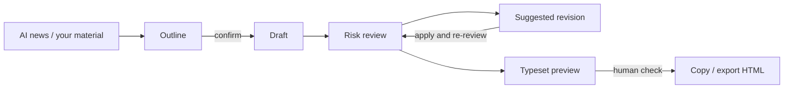

<div align="center">

**English** | [简体中文](README.zh-CN.md) | [繁體中文](README.zh-TW.md) | [日本語](README.ja.md) | [한국어](README.ko.md) | [Deutsch](README.de.md) | [Français](README.fr.md) | [Español](README.es.md) | [Português](README.pt-BR.md) | [Русский](README.ru.md)

# TrendPublish

A local, human-in-the-loop AI writing desk for WeChat Official Account articles: material → outline → draft → risk review → revision → export.

[](LICENSE)
[](https://deno.com/)
[](https://www.typescriptlang.org/)


</div>

> [!NOTE]
> The workbench UI, the writing prompts and the review rules are in Simplified Chinese and target Chinese WeChat Official Account readers. This repository is a fork of [liyown/ai-trend-publish](https://github.com/liyown/ai-trend-publish); the original automated publishing pipeline is still included (see [Upstream features](#upstream-features)).

## Features

- **Pick a topic from AI news**: reads the public RSS feeds of OpenAI and Hugging Face on demand (cached for 5 minutes), sorted by publish time, with links and dates kept. Select up to 5 items as sources.
- **Outline first, then draft**: write the outline yourself or let the model draft it. You must confirm the outline before the article is generated; editing the topic, material or outline resets the confirmation.
- **Independent risk review**: every draft (generated or hand-written) can be reviewed across six dimensions: platform, privacy, fact, style, readability and rights. Each issue quotes the exact sentence, gives a suggestion and cites rule IDs.
- **Suggested revision**: generates a revised draft that only touches the quoted sentences and lists every change with its rule ID. You compare and decide whether to apply it.
- **WeChat-ready export**: renders the article with the upstream `minimal` WeChat template. Copy it as rich text or download HTML / Markdown.
- **Local and private by default**: the server listens on `127.0.0.1` only, rejects cross-origin writes, and scans your input for common credentials, phone numbers, ID numbers and email addresses before anything is sent to the model.
- **No silent failures**: a review that was truncated or did not finish is never treated as passed, and your draft is kept when a model call fails.

<!-- screenshot: review panel -->

## Workflow



1. **Material**: choose sources from the news list and/or paste your own excerpts and notes.
2. **Outline**: generate or write one, then confirm it.
3. **Draft**: generate the article and edit it freely in the editor.
4. **Risk review**: check the current draft against the P and E rules (see below).
5. **Revision**: generate a suggested revision, compare, apply, and review again.
6. **Export**: update the typeset preview, tick the manual check, then copy or export. Publish manually from the WeChat backend.

<!-- screenshot: outline and draft editor -->

## Quick start

**Requirements**: [Deno 2](https://docs.deno.com/runtime/getting_started/installation/) and a DeepSeek API key.

```sh
git clone https://github.com/TinkCarlos/trendpublish.git
cd trendpublish
deno task simple
```

Then open <http://127.0.0.1:8000>. The task builds the web page and starts the local server.

**Model setup**, either way works:

- In the page, open **模型设置** (Model settings) and enter your DeepSeek API key and model name (default `deepseek-flash`). The settings are saved to `src/temp/simple-model.json` with file mode `600`; this directory is git-ignored.
- Or provide environment variables when starting. They are used only if `src/temp/simple-model.json` does not exist:

  ```sh
  DEEPSEEK_API_KEY=<your-deepseek-api-key> DEEPSEEK_MODEL=deepseek-flash deno task simple
  ```

Saving the settings does not call the model. Your material and outline are sent to the DeepSeek API (`https://api.deepseek.com/v1`) only when you generate or review, and that uses your account's quota.

## Configuration

| Setting | Default | Notes |
|---|---|---|
| `SIMPLE_PORT` | `8000` | Port of the local server, `1024`–`65535`. |
| `SIMPLE_REASONING_EFFORT` | `max` | `max` or `high`. Applies to outline, draft, review and revision. Any other value stops the server at startup. Restart to apply. |
| `DEEPSEEK_API_KEY` / `DEEPSEEK_MODEL` | — / `deepseek-flash` | Fallback when no settings file exists. |
| `SIMPLE_DEBUG_ARTICLE_MAX_TOKENS` | unset | **Debug only.** Lowers the draft token limit (`64`–`32768`) to exercise the automatic retry. The draft will almost always fail; remove it and restart afterwards. |

Per-step limits (set in code, thinking mode is always on, and thinking tokens share the output budget):

| Step | Max output tokens | Request timeout |
|---|---|---|
| Outline | 16,384 | 600 s |
| Draft | 32,768 | 600 s |
| Risk review | 65,536 | 600 s |
| Suggested revision | 32,768 | 600 s |

Only one generation runs at a time; a second request gets HTTP `409` until the first one finishes. `GET /api/simple/status` reports the current step and attempt.

## Risk review rules

The rules live in [`src/apps/simple/editorial-rules.ts`](src/apps/simple/editorial-rules.ts) and are versioned (`RULE_VERSION`). Changing the rule version invalidates earlier reviews.

- **P rules (P1–P11)** are based on public sources, each linked with its date and authority level: WeChat Official Account operation and recommendation specifications, the measures for labeling AI-generated content, notices on self-media governance and traffic integrity, the Internet Advertising Measures and the Advertising Law of the PRC. They cover clickbait titles, impersonation, AI labeling and attribution, unsupported facts and outdated news, professional advice, event sourcing, manufactured anxiety, share-to-unlock tricks, undisclosed advertising, absolute claims and guaranteed-income promises.
- **E rules (E1–E7)** are editorial experience: reader value, natural Chinese without translationese, structure that fits the genre, learning from samples without copying, whether the opening makes sense to an outsider, flat stretches, and what the reader takes away.
- Factual errors (wrong numbers or attributions, contradictions, arithmetic that does not add up) must cite **P4**.

The review does not predict WeChat recommendation, does not score "AI-ness", and does not guarantee compliance. Uncertain facts and copyright or licensing questions are left for a human to verify.

## Automatic retry and AI disclosure

- **Automatic retry**: with thinking enabled, the model occasionally spends its whole token budget on reasoning and returns no text. If an outline or draft stops with `finish_reason: length` **and** empty content, the server retries exactly once; the page shows the second attempt. A truncated response that does contain text is reported as an error instead of being retried.
- **AI disclosure, once**: when the article is marked as AI-assisted, export appends `本文使用 AI 辅助创作。` ("This article was written with AI assistance."). Any similar statement the model wrote into the body is removed first, so the exported article has exactly one disclosure. You should still use the AI-content declaration in the WeChat backend when publishing.

<!-- screenshot: export with AI disclosure -->

## Tests

```sh
deno task simple:test
deno check src/apps/simple/server.ts scripts/simple.ts
deno check --config dashboard/deno.json dashboard/src/env.d.ts dashboard/src/simple.tsx
```

## Project structure

```text
.
├── scripts/simple.ts            # builds the page and starts the local workbench
├── src/apps/simple/
│   ├── server.ts                # loopback-only HTTP API (/api/simple/*)
│   ├── workbench.ts             # news, outline, draft, render
│   ├── editorial.ts             # risk review and suggested revision
│   ├── editorial-rules.ts       # P/E rules, sources, RULE_VERSION
│   ├── writing-style.ts         # writing style prompt
│   ├── privacy.ts               # local privacy scan, AI disclosure handling
│   ├── review-contract.ts       # review result types: six categories, severity, rule IDs
│   ├── effort.ts                # SIMPLE_REASONING_EFFORT
│   └── *.test.ts
├── dashboard/
│   ├── simple.html
│   └── src/simple.tsx           # workbench UI
├── src/features/weixin-article/ # upstream WeChat rendering templates and pipeline
└── docs/                        # upstream and project documentation
```

## Upstream features

The full automated pipeline from upstream (scheduled topic selection, Dashboard, WeChat draft publishing, Docker and Cloudflare deployment) is still in this repository and starts with `deno task dev`. See [`docs/`](docs/) for details. Do not run it on port 8000 at the same time as the workbench.

## Acknowledgements

This project is based on [liyown/ai-trend-publish](https://github.com/liyown/ai-trend-publish) by Yaowen Liu, and reuses its RSS provider, OpenAI-compatible model client and `minimal` WeChat template. Many thanks to the upstream author and contributors.

## License

[MIT](LICENSE). The original copyright notice of the upstream project is retained.

## Contributing

Issues and pull requests are welcome. Pull requests are reviewed and merged by the maintainer. Please run `deno task simple:test` before submitting, and never include API keys or personal data in issues, commits or test fixtures.
