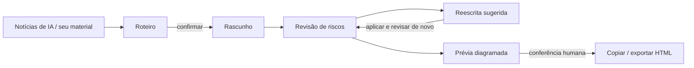

<div align="center">

[English](README.md) | [简体中文](README.zh-CN.md) | [繁體中文](README.zh-TW.md) | [日本語](README.ja.md) | [한국어](README.ko.md) | [Deutsch](README.de.md) | [Français](README.fr.md) | [Español](README.es.md) | **Português** | [Русский](README.ru.md)

# TrendPublish

Uma mesa de redação com IA, local e com um humano no controle, para artigos de contas oficiais do WeChat: material → roteiro → rascunho → revisão de riscos → reescrita → exportação.

[](LICENSE)
[](https://deno.com/)
[](https://www.typescriptlang.org/)


</div>

> [!NOTE]
> A interface, os prompts de escrita e as regras de revisão estão em chinês simplificado e são voltados para leitores chineses de contas oficiais do WeChat. Este repositório é um fork de [liyown/ai-trend-publish](https://github.com/liyown/ai-trend-publish); o pipeline original de publicação automatizada continua incluído (veja [Recursos do projeto original](#recursos-do-projeto-original)).

## Recursos

- **Escolha um tema a partir de notícias de IA**: lê sob demanda os feeds RSS públicos da OpenAI e da Hugging Face (com cache de 5 minutos), ordenados por data de publicação, mantendo links e datas. Dá para selecionar até 5 itens como fontes.
- **Primeiro o roteiro, depois o rascunho**: escreva o roteiro você mesmo ou deixe o modelo propor um. É preciso confirmar o roteiro antes de gerar o artigo; editar o tema, o material ou o roteiro desfaz a confirmação.
- **Revisão de riscos independente**: todo rascunho, gerado ou escrito à mão, pode ser revisado em seis dimensões: plataforma, privacidade, fatos, estilo, legibilidade e direitos. Cada problema cita a frase exata, traz uma sugestão e indica os IDs das regras.
- **Reescrita sugerida**: gera uma versão revisada que mexe só nas frases citadas e lista cada alteração com o ID da regra. Você compara e decide se aplica.
- **Exportação pronta para o WeChat**: diagrama o artigo com o template `minimal` do WeChat herdado do projeto original. Copie como texto formatado ou baixe em HTML / Markdown.
- **Local e privado por padrão**: o servidor escuta apenas em `127.0.0.1`, recusa gravações cross-origin e, antes de enviar qualquer coisa ao modelo, verifica se o seu texto contém credenciais comuns, números de telefone, números de documento de identidade ou endereços de e-mail.
- **Nada de falhas silenciosas**: uma revisão truncada ou que não terminou nunca é tratada como aprovada, e o seu rascunho é preservado quando uma chamada ao modelo falha.


_Conteúdo de demonstração: o resultado da revisão nesta captura de tela é um dado de exemplo._

## Fluxo de trabalho



1. **Material**: escolha fontes na lista de notícias e/ou cole seus próprios trechos e anotações.
2. **Roteiro**: gere um ou escreva o seu, depois confirme.
3. **Rascunho**: gere o artigo e edite à vontade no editor.
4. **Revisão de riscos**: verifique o rascunho atual com as regras P e E (veja abaixo).
5. **Reescrita**: gere uma reescrita sugerida, compare, aplique e revise de novo.
6. **Exportação**: atualize a prévia diagramada, marque a conferência manual e depois copie ou exporte. A publicação é feita manualmente pelo painel do WeChat.


_Conteúdo de demonstração: o roteiro e o artigo acima são um exemplo escrito para este README._

## Início rápido

**Requisitos**: [Deno 2](https://docs.deno.com/runtime/getting_started/installation/) e uma chave de API da DeepSeek.

```sh
git clone https://github.com/TinkCarlos/trendpublish.git
cd trendpublish
deno task simple
```

Depois abra <http://127.0.0.1:8000>. A task compila a página web e inicia o servidor local.

**Configuração do modelo**, de qualquer uma das duas formas:

- Na página, abra **模型设置** (Configurações do modelo) e informe sua chave de API da DeepSeek e o nome do modelo (padrão `deepseek-flash`). As configurações são salvas em `src/temp/simple-model.json` com permissão `600`; esse diretório é ignorado pelo git.
- Ou passe variáveis de ambiente ao iniciar. Elas só são usadas se `src/temp/simple-model.json` não existir:

  ```sh
  DEEPSEEK_API_KEY=<your-deepseek-api-key> DEEPSEEK_MODEL=deepseek-flash deno task simple
  ```

Salvar as configurações não chama o modelo. Seu material e seu roteiro só são enviados para a API da DeepSeek (`https://api.deepseek.com/v1`) quando você gera ou revisa, e isso consome a cota da sua conta.

## Configuração

| Opção | Padrão | Observações |
|---|---|---|
| `SIMPLE_PORT` | `8000` | Porta do servidor local, `1024`–`65535`. |
| `SIMPLE_REASONING_EFFORT` | `max` | `max` ou `high`. Vale para roteiro, rascunho, revisão e reescrita. Qualquer outro valor faz o servidor parar na inicialização. Reinicie para aplicar. |
| `DEEPSEEK_API_KEY` / `DEEPSEEK_MODEL` | — / `deepseek-flash` | Alternativa quando não existe arquivo de configurações. |
| `SIMPLE_DEBUG_ARTICLE_MAX_TOKENS` | não definido | **Só para depuração.** Reduz o limite de tokens do rascunho (`64`–`32768`) para acionar a nova tentativa automática. O rascunho vai falhar quase sempre; remova a variável e reinicie depois. |

Limites por etapa (definidos no código; o modo de raciocínio fica sempre ligado, e os tokens de raciocínio dividem o orçamento de saída):

| Etapa | Máx. de tokens de saída | Timeout da requisição |
|---|---|---|
| Roteiro | 16384 | 600 s |
| Rascunho | 32768 | 600 s |
| Revisão de riscos | 65536 | 600 s |
| Reescrita sugerida | 32768 | 600 s |

Só uma geração roda por vez; uma segunda requisição recebe HTTP `409` até a primeira terminar. `GET /api/simple/status` informa a etapa e a tentativa atuais.

## Regras da revisão de riscos

As regras ficam em [`src/apps/simple/editorial-rules.ts`](src/apps/simple/editorial-rules.ts) e são versionadas (`RULE_VERSION`). Mudar a versão das regras invalida as revisões anteriores.

- **As regras P (P1–P11)** se baseiam em fontes públicas, cada uma com link, data e nível de autoridade: as normas de operação e de recomendação das contas oficiais do WeChat, as medidas de rotulagem de conteúdo gerado por IA, os avisos sobre a governança de mídias independentes e a autenticidade do tráfego, as Medidas de Publicidade na Internet e a Lei de Publicidade da República Popular da China. Elas cobrem títulos caça-cliques, uso de identidade falsa, rotulagem de IA e atribuição, fatos sem respaldo e notícias desatualizadas, aconselhamento profissional, fontes de acontecimentos, ansiedade fabricada, truques de “compartilhe para desbloquear”, publicidade não declarada, afirmações absolutas e promessas de renda garantida.
- **As regras E (E1–E7)** vêm da experiência editorial: valor para o leitor, um chinês natural sem cara de tradução, estrutura adequada ao gênero, aprender com exemplos sem copiar, se a abertura faz sentido para quem é de fora, trechos arrastados e o que o leitor leva no final.
- Erros factuais (números ou atribuições errados, contradições, contas que não fecham) devem citar **P4**.

A revisão não prevê a recomendação do WeChat, não dá nota para o quanto o texto “parece IA” e não garante conformidade. Fatos incertos e questões de direitos autorais ou licenciamento ficam para uma pessoa verificar.

## Nova tentativa automática e aviso de IA

- **Nova tentativa automática**: com o raciocínio ativado, o modelo às vezes gasta todo o orçamento de tokens pensando e não devolve texto nenhum. Se um roteiro ou rascunho parar com `finish_reason: length` **e** conteúdo vazio, o servidor tenta de novo exatamente uma vez; a página mostra a segunda tentativa. Uma resposta truncada que contém texto é reportada como erro, sem nova tentativa.
- **Aviso de IA, uma vez só**: quando o artigo está marcado como feito com ajuda de IA, a exportação acrescenta `本文使用 AI 辅助创作。` (“Este artigo foi escrito com a ajuda de IA.”). Qualquer aviso parecido que o modelo tenha escrito no corpo do texto é removido antes, então o artigo exportado tem exatamente um aviso. Ao publicar, use também a declaração de conteúdo de IA no painel do WeChat.

## Testes

```sh
deno task simple:test
deno check src/apps/simple/server.ts scripts/simple.ts
deno check --config dashboard/deno.json dashboard/src/env.d.ts dashboard/src/simple.tsx
```

## Estrutura do projeto

```text
.
├── scripts/simple.ts            # builds the page and starts the local workbench
├── src/apps/simple/
│   ├── server.ts                # loopback-only HTTP API (/api/simple/*)
│   ├── workbench.ts             # news, outline, draft, render
│   ├── editorial.ts             # risk review and suggested revision
│   ├── editorial-rules.ts       # P/E rules, sources, RULE_VERSION
│   ├── writing-style.ts         # writing style prompt
│   ├── privacy.ts               # local privacy scan, AI disclosure handling
│   ├── review-contract.ts       # review result types: six categories, severity, rule IDs
│   ├── effort.ts                # SIMPLE_REASONING_EFFORT
│   └── *.test.ts
├── dashboard/
│   ├── simple.html
│   └── src/simple.tsx           # workbench UI
├── src/features/weixin-article/ # upstream WeChat rendering templates and pipeline
└── docs/                        # upstream and project documentation
```

## Recursos do projeto original

O pipeline automatizado completo do projeto original (seleção agendada de temas, Dashboard, publicação de rascunhos no WeChat, deploy com Docker e Cloudflare) continua neste repositório e é iniciado com `deno task dev`. Veja [`docs/`](docs/) para mais detalhes. Não rode ele na porta 8000 ao mesmo tempo que a área de trabalho.

## Agradecimentos

Este projeto é baseado no [liyown/ai-trend-publish](https://github.com/liyown/ai-trend-publish), de Yaowen Liu, e reaproveita o provedor de RSS, o cliente de modelos compatível com OpenAI e o template `minimal` do WeChat. Muito obrigado ao autor original e aos contribuidores.

## Licença

[MIT](LICENSE). O aviso de copyright original do projeto upstream foi mantido.

## Como contribuir

Issues e pull requests são bem-vindos. Os pull requests são revisados e mesclados pelo mantenedor. Rode `deno task simple:test` antes de enviar e nunca inclua chaves de API ou dados pessoais em issues, commits ou fixtures de teste.
