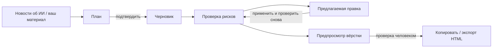

<div align="center">

[English](README.md) | [简体中文](README.zh-CN.md) | [繁體中文](README.zh-TW.md) | [日本語](README.ja.md) | [한국어](README.ko.md) | [Deutsch](README.de.md) | [Français](README.fr.md) | [Español](README.es.md) | [Português](README.pt-BR.md) | **Русский**

# TrendPublish

Локальный ИИ-редактор статей для официальных аккаунтов WeChat, где каждый шаг контролирует человек: материал → план → черновик → проверка рисков → правка → экспорт.

[](LICENSE)
[](https://deno.com/)
[](https://www.typescriptlang.org/)


</div>

> [!NOTE]
> Интерфейс, промпты для написания текстов и правила проверки — на упрощённом китайском и рассчитаны на китайских читателей официальных аккаунтов WeChat. Этот репозиторий — форк [liyown/ai-trend-publish](https://github.com/liyown/ai-trend-publish); исходный конвейер автоматической публикации по-прежнему входит в него (см. [Возможности исходного проекта](#возможности-исходного-проекта)).

## Возможности

- **Тема из новостей об ИИ**: по запросу читает публичные RSS-ленты OpenAI и Hugging Face (кэш на 5 минут), сортирует по времени публикации и сохраняет ссылки и даты. В качестве источников можно выбрать до 5 записей.
- **Сначала план, потом черновик**: план можно написать самому или поручить модели. Перед генерацией статьи план нужно подтвердить; если изменить тему, материал или план, подтверждение сбрасывается.
- **Независимая проверка рисков**: любой черновик — сгенерированный или написанный вручную — можно проверить по шести направлениям: платформа, приватность, факты, стиль, читаемость и права. Для каждой проблемы приводится точная цитата, предложение по исправлению и идентификаторы правил.
- **Предлагаемая правка**: генерирует исправленную версию, в которой меняются только процитированные предложения, и перечисляет каждое изменение с идентификатором правила. Вы сравниваете и решаете, применять ли её.
- **Экспорт, готовый для WeChat**: вёрстка статьи по шаблону WeChat `minimal` из исходного проекта. Можно скопировать как форматированный текст или скачать HTML / Markdown.
- **Локально и приватно по умолчанию**: сервер слушает только `127.0.0.1`, отклоняет кросс-доменные запросы на запись и, прежде чем что-либо отправить модели, проверяет ваш ввод на распространённые учётные данные, номера телефонов, номера удостоверений личности и адреса электронной почты.
- **Никаких тихих сбоев**: обрезанная или незавершённая проверка никогда не считается пройденной, а черновик сохраняется, если вызов модели завершился ошибкой.


_Демо-контент: результат проверки на этом скриншоте — пример данных._

## Как это работает



1. **Материал**: выберите источники из списка новостей и/или вставьте свои выдержки и заметки.
2. **План**: сгенерируйте или напишите его, затем подтвердите.
3. **Черновик**: сгенерируйте статью и свободно редактируйте её в редакторе.
4. **Проверка рисков**: проверьте текущий черновик по правилам P и E (см. ниже).
5. **Правка**: сгенерируйте предлагаемую правку, сравните, примените и проверьте снова.
6. **Экспорт**: обновите предпросмотр вёрстки, отметьте ручную проверку, затем скопируйте или экспортируйте. Публикация выполняется вручную в панели управления WeChat.


_Демо-контент: план и статья выше — пример, написанный для этого README._

## Быстрый старт

**Требования**: [Deno 2](https://docs.deno.com/runtime/getting_started/installation/) и API-ключ DeepSeek.

```sh
git clone https://github.com/TinkCarlos/ai-writing-desk.git
cd ai-writing-desk
deno task simple
```

Затем откройте <http://127.0.0.1:8000>. Задача собирает веб-страницу и запускает локальный сервер.

**Настройка модели** — подойдёт любой из двух способов:

- На странице откройте **模型设置** (настройки модели) и введите API-ключ DeepSeek и название модели (по умолчанию `deepseek-flash`). Настройки сохраняются в `src/temp/simple-model.json` с правами `600`; этот каталог игнорируется git.
- Или передайте переменные окружения при запуске. Они используются, только если `src/temp/simple-model.json` не существует:

  ```sh
  DEEPSEEK_API_KEY=<your-deepseek-api-key> DEEPSEEK_MODEL=deepseek-flash deno task simple
  ```

Сохранение настроек не вызывает модель. Материал и план отправляются в API DeepSeek (`https://api.deepseek.com/v1`) только при генерации или проверке, и на это расходуется квота вашего аккаунта.

## Конфигурация

| Параметр | По умолчанию | Примечания |
|---|---|---|
| `SIMPLE_PORT` | `8000` | Порт локального сервера, `1024`–`65535`. |
| `SIMPLE_REASONING_EFFORT` | `max` | `max` или `high`. Применяется к плану, черновику, проверке и правке. Любое другое значение останавливает сервер при запуске. Вступает в силу после перезапуска. |
| `DEEPSEEK_API_KEY` / `DEEPSEEK_MODEL` | — / `deepseek-flash` | Запасной вариант, если файла настроек нет. |
| `SIMPLE_DEBUG_ARTICLE_MAX_TOKENS` | не задан | **Только для отладки.** Снижает лимит токенов для черновика (`64`–`32768`), чтобы проверить автоматический повтор. Черновик почти наверняка не сгенерируется; после отладки удалите переменную и перезапустите сервер. |

Лимиты по шагам (заданы в коде; режим рассуждений всегда включён, и токены на рассуждения расходуются из того же бюджета вывода):

| Шаг | Макс. токенов на выходе | Тайм-аут запроса |
|---|---|---|
| План | 16384 | 600 с |
| Черновик | 32768 | 600 с |
| Проверка рисков | 65536 | 600 с |
| Предлагаемая правка | 32768 | 600 с |

Одновременно выполняется только одна генерация; пока первая не завершится, второй запрос получает HTTP `409`. `GET /api/simple/status` сообщает текущий шаг и номер попытки.

## Правила проверки рисков

Правила находятся в [`src/apps/simple/editorial-rules.ts`](src/apps/simple/editorial-rules.ts) и версионируются (`RULE_VERSION`). Смена версии правил делает прежние проверки недействительными.

- **Правила P (P1–P11)** основаны на открытых источниках, у каждого указаны ссылка, дата и уровень юридической силы: правила работы и рекомендаций для официальных аккаунтов WeChat, порядок маркировки контента, созданного ИИ, уведомления о регулировании самиздат-медиа и подлинности трафика, Положение об интернет-рекламе и Закон КНР о рекламе. Они охватывают кликбейтные заголовки, выдачу себя за другое лицо, маркировку ИИ и указание авторства, неподтверждённые факты и устаревшие новости, профессиональные советы, источники сведений о событиях, нагнетание тревоги, уловки вида «поделись, чтобы открыть», нераскрытую рекламу, абсолютные утверждения и обещания гарантированного дохода.
- **Правила E (E1–E7)** — это редакторский опыт: ценность для читателя, естественный китайский без переводческих оборотов, структура, подходящая жанру, умение учиться на образцах, не копируя их, понятно ли начало постороннему человеку, провисающие места и то, что читатель вынесет из текста.
- Фактические ошибки (неверные числа или атрибуция, противоречия, не сходящиеся расчёты) обязательно ссылаются на **P4**.

Проверка не предсказывает рекомендации WeChat, не оценивает, насколько текст «похож на ИИ», и не гарантирует соответствие требованиям. Сомнительные факты и вопросы авторских прав и лицензий оставлены на проверку человеку.

## Автоматический повтор и пометка об ИИ

- **Автоматический повтор**: при включённых рассуждениях модель иногда тратит весь бюджет токенов на рассуждения и не возвращает текста. Если план или черновик завершается с `finish_reason: length` **и** пустым содержимым, сервер повторяет запрос ровно один раз; на странице отображается вторая попытка. Обрезанный ответ, в котором есть текст, вместо повтора возвращается как ошибка.
- **Пометка об ИИ — ровно одна**: если статья отмечена как созданная с помощью ИИ, при экспорте добавляется `本文使用 AI 辅助创作。` («Статья написана с помощью ИИ.»). Похожие фразы, которые модель вписала в текст, предварительно удаляются, поэтому в экспортированной статье ровно одна такая пометка. При публикации всё равно используйте декларацию ИИ-контента в панели управления WeChat.

## Тесты

```sh
deno task simple:test
deno check src/apps/simple/server.ts scripts/simple.ts
deno check --config dashboard/deno.json dashboard/src/env.d.ts dashboard/src/simple.tsx
```

## Структура проекта

```text
.
├── scripts/simple.ts            # builds the page and starts the local workbench
├── src/apps/simple/
│   ├── server.ts                # loopback-only HTTP API (/api/simple/*)
│   ├── workbench.ts             # news, outline, draft, render
│   ├── editorial.ts             # risk review and suggested revision
│   ├── editorial-rules.ts       # P/E rules, sources, RULE_VERSION
│   ├── writing-style.ts         # writing style prompt
│   ├── privacy.ts               # local privacy scan, AI disclosure handling
│   ├── review-contract.ts       # review result types: six categories, severity, rule IDs
│   ├── effort.ts                # SIMPLE_REASONING_EFFORT
│   └── *.test.ts
├── dashboard/
│   ├── simple.html
│   └── src/simple.tsx           # workbench UI
├── src/features/weixin-article/ # upstream WeChat rendering templates and pipeline
└── docs/                        # upstream and project documentation
```

## Возможности исходного проекта

Полный автоматизированный конвейер исходного проекта (отбор тем по расписанию, Dashboard, публикация черновиков в WeChat, развёртывание через Docker и Cloudflare) по-прежнему есть в этом репозитории и запускается командой `deno task dev`. Подробности — в [`docs/`](docs/). Не запускайте его на порту 8000 одновременно с рабочим местом.

## Благодарности

Проект основан на [liyown/ai-trend-publish](https://github.com/liyown/ai-trend-publish) от Yaowen Liu и повторно использует его RSS-провайдер, OpenAI-совместимый клиент модели и шаблон WeChat `minimal`. Большое спасибо автору исходного проекта и всем контрибьюторам.

## Лицензия

[MIT](LICENSE). Исходное уведомление об авторских правах оригинального проекта сохранено.

## Участие в разработке

Issues и pull requests приветствуются. Pull requests проверяет и сливает мейнтейнер. Перед отправкой запустите `deno task simple:test` и никогда не добавляйте API-ключи или персональные данные в issues, коммиты или тестовые фикстуры.
