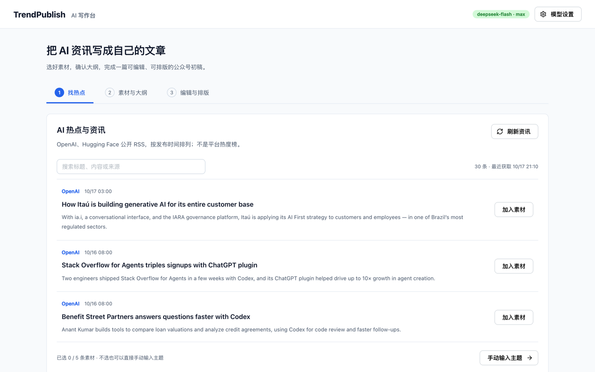
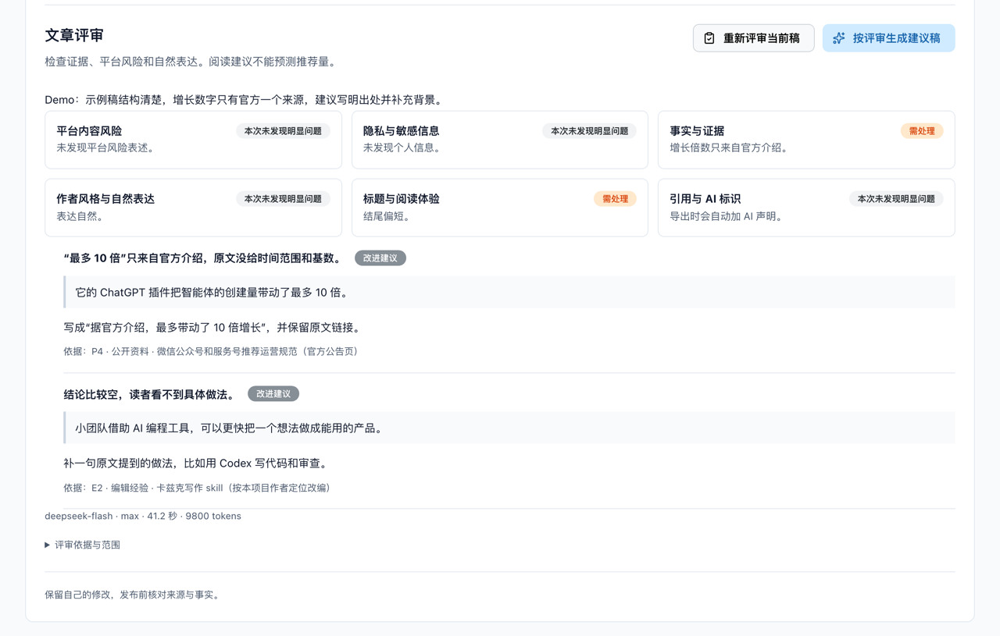
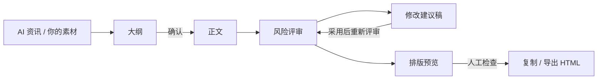
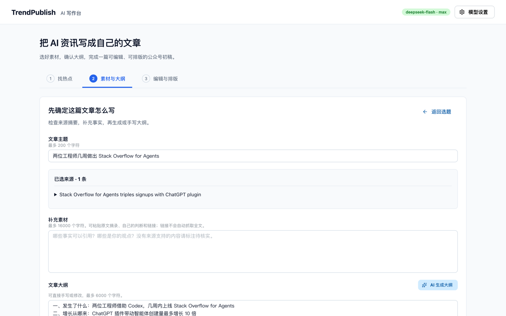
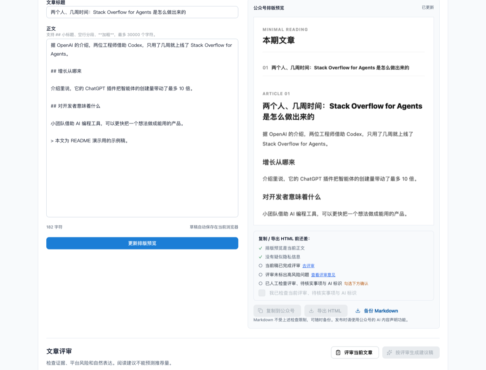

<div align="center">

[English](README.md) | **简体中文** | [繁體中文](README.zh-TW.md) | [日本語](README.ja.md) | [한국어](README.ko.md) | [Deutsch](README.de.md) | [Français](README.fr.md) | [Español](README.es.md) | [Português](README.pt-BR.md) | [Русский](README.ru.md)

# TrendPublish

一个在本地运行、由人把关的微信公众号 AI 写作台：素材 → 大纲 → 正文 → 风险评审 → 修改 → 导出。

[](LICENSE)
[](https://deno.com/)
[](https://www.typescriptlang.org/)



</div>

> [!NOTE]
> 工作台界面、写作提示词和评审规则都是中文的，面向国内的微信公众号读者。本仓库 fork 自 [liyown/ai-trend-publish](https://github.com/liyown/ai-trend-publish)，上游原有的自动化发布流程仍然保留（见[上游功能](#上游功能)）。

## 功能

- **从 AI 资讯里挑选题**：按需读取 OpenAI 和 Hugging Face 的公开 RSS（缓存 5 分钟），按发布时间排序，保留链接和日期。最多可选 5 条作为素材。
- **先定大纲，再写正文**：大纲可以自己写，也可以让模型起草。必须先确认大纲才能生成正文；改动选题、素材或大纲后，确认状态会被重置。
- **独立的风险评审**：每篇正文（不管是生成的还是手写的）都可以从平台、隐私、事实、文风、可读性和权益六个维度评审。每个问题都会引用原句、给出建议，并标注规则编号。
- **修改建议稿**：生成一版只改动被引用句子的修改稿，逐条列出每处改动及对应的规则编号。由你对比后决定是否采用。
- **导出即可用于公众号**：用上游的 `minimal` 微信模板排版，可以复制为富文本，也可以下载 HTML / Markdown。
- **默认本地、默认私密**：服务只监听 `127.0.0.1`，拒绝跨域写请求；内容发给模型之前，会先扫描你的输入里有没有常见的凭据、手机号、身份证号和邮箱地址。
- **不会悄悄失败**：被截断或没跑完的评审一律不算通过；模型调用失败时，你的正文会保留下来。



_示例内容：截图中的评审结果为演示数据。_

## 工作流程



1. **素材**：从资讯列表里选来源，也可以粘贴自己的摘录和笔记，或者两样都用。
2. **大纲**：生成或自己写一份，然后确认。
3. **正文**：生成文章，在编辑器里随意修改。
4. **风险评审**：按 P 规则和 E 规则检查当前正文（见下文）。
5. **修改**：生成修改建议稿，对比、采用，再重新评审。
6. **导出**：更新排版预览，勾选人工检查，然后复制或导出。最后到公众号后台手动发布。





_示例内容：以上大纲和文章是为本 README 编写的示例。_

## 快速开始

**环境要求**：[Deno 2](https://docs.deno.com/runtime/getting_started/installation/) 和一个 DeepSeek API key。

```sh
git clone https://github.com/TinkCarlos/ai-writing-desk.git
cd ai-writing-desk
deno task simple
```

然后打开 <http://127.0.0.1:8000>。这个任务会先构建网页，再启动本地服务。

**模型配置**，下面两种方式任选其一：

- 在页面里打开 **模型设置**，填入你的 DeepSeek API key 和模型名称（默认 `deepseek-flash`）。设置会保存到 `src/temp/simple-model.json`，文件权限为 `600`；这个目录已被 git 忽略。
- 也可以在启动时通过环境变量提供。只有 `src/temp/simple-model.json` 不存在时才会用到它们：

  ```sh
  DEEPSEEK_API_KEY=<your-deepseek-api-key> DEEPSEEK_MODEL=deepseek-flash deno task simple
  ```

保存设置不会调用模型。只有在你生成或评审时，素材和大纲才会发送到 DeepSeek API（`https://api.deepseek.com/v1`），消耗的是你账户的额度。

## 配置

| 配置项 | 默认值 | 说明 |
|---|---|---|
| `SIMPLE_PORT` | `8000` | 本地服务端口，范围 `1024`–`65535`。 |
| `SIMPLE_REASONING_EFFORT` | `max` | `max` 或 `high`。作用于大纲、正文、评审和修改。填其他值时服务在启动阶段就会退出。改完需重启生效。 |
| `DEEPSEEK_API_KEY` / `DEEPSEEK_MODEL` | — / `deepseek-flash` | 没有设置文件时的后备配置。 |
| `SIMPLE_DEBUG_ARTICLE_MAX_TOKENS` | 未设置 | **仅用于调试。** 调低正文的 token 上限（`64`–`32768`），用来触发自动重试。正文几乎一定会失败；调试完请删掉它并重启。 |

各步骤的上限（写在代码里；思考模式始终开启，思考用的 token 也计入输出预算）：

| 步骤 | 最大输出 token | 请求超时 |
|---|---|---|
| 大纲 | 16,384 | 600 秒 |
| 正文 | 32,768 | 600 秒 |
| 风险评审 | 65,536 | 600 秒 |
| 修改建议稿 | 32,768 | 600 秒 |

同一时间只跑一个生成任务；第一个完成之前，第二个请求会收到 HTTP `409`。`GET /api/simple/status` 会返回当前所处的步骤和第几次尝试。

## 风险评审规则

规则定义在 [`src/apps/simple/editorial-rules.ts`](src/apps/simple/editorial-rules.ts) 里，并带有版本号（`RULE_VERSION`）。规则版本一变，之前的评审结果就会失效。

- **P 规则（P1–P11）** 依据公开来源，每条都附有链接、日期和效力层级：微信公众号运营规范和推荐规范、人工智能生成合成内容标识办法、关于自媒体治理和流量真实性的通知、《互联网广告管理办法》以及《中华人民共和国广告法》。涵盖标题党、冒充身份、AI 标识与来源标注、无依据的事实和过时新闻、专业建议、事件信源、制造焦虑、诱导分享解锁、未标明的广告、绝对化用语和收益承诺。
- **E 规则（E1–E7）** 来自编辑经验：对读者有没有价值、中文是否自然、没有翻译腔、结构是否贴合文体、借鉴范文而不照抄、开头外行能不能看懂、有没有平淡拖沓的段落，以及读者最后能带走什么。
- 事实性错误（数字或出处有误、前后矛盾、算术对不上）必须引用 **P4**。

评审不预测公众号推荐效果，不给“AI 味”打分，也不保证合规。拿不准的事实以及版权、授权问题，留给人来核实。

## 自动重试与 AI 声明

- **自动重试**：开启思考时，模型偶尔会把全部 token 预算花在推理上，最后一个字也没输出。如果大纲或正文以 `finish_reason: length` 结束**并且**内容为空，服务会重试，且只重试一次；页面上显示的是第二次的结果。如果响应被截断但有内容，会作为错误报出来，而不是重试。
- **AI 声明只出现一次**：文章标记为 AI 辅助创作时，导出会在末尾追加 `本文使用 AI 辅助创作。`。模型写进正文的类似声明会先被删掉，所以导出的文章里恰好只有一条声明。发布时仍然应该在公众号后台使用 AI 内容声明功能。

## 测试

```sh
deno task simple:test
deno check src/apps/simple/server.ts scripts/simple.ts
deno check --config dashboard/deno.json dashboard/src/env.d.ts dashboard/src/simple.tsx
```

## 项目结构

```text
.
├── scripts/simple.ts            # builds the page and starts the local workbench
├── src/apps/simple/
│   ├── server.ts                # loopback-only HTTP API (/api/simple/*)
│   ├── workbench.ts             # news, outline, draft, render
│   ├── editorial.ts             # risk review and suggested revision
│   ├── editorial-rules.ts       # P/E rules, sources, RULE_VERSION
│   ├── writing-style.ts         # writing style prompt
│   ├── privacy.ts               # local privacy scan, AI disclosure handling
│   ├── review-contract.ts       # review result types: six categories, severity, rule IDs
│   ├── effort.ts                # SIMPLE_REASONING_EFFORT
│   └── *.test.ts
├── dashboard/
│   ├── simple.html
│   └── src/simple.tsx           # workbench UI
├── src/features/weixin-article/ # upstream WeChat rendering templates and pipeline
└── docs/                        # upstream and project documentation
```

## 上游功能

上游完整的自动化流程（定时选题、Dashboard、公众号草稿发布、Docker 和 Cloudflare 部署）仍然保留在本仓库里，用 `deno task dev` 启动。详见 [`docs/`](docs/)。不要和工作台同时跑在 8000 端口上。

## 致谢

本项目基于 Yaowen Liu 的 [liyown/ai-trend-publish](https://github.com/liyown/ai-trend-publish)，复用了其中的 RSS 数据源、兼容 OpenAI 的模型客户端和 `minimal` 微信模板。衷心感谢上游作者和各位贡献者。

## 许可证

[MIT](LICENSE)。保留上游项目原有的版权声明。

## 参与贡献

欢迎提 Issue 和 Pull Request。Pull Request 由维护者审核并合并。提交前请先运行 `deno task simple:test`，也请不要在 Issue、提交记录或测试数据里包含 API key 或个人数据。
