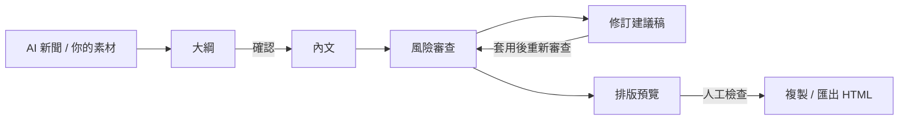

<div align="center">

[English](README.md) | [简体中文](README.zh-CN.md) | **繁體中文** | [日本語](README.ja.md) | [한국어](README.ko.md) | [Deutsch](README.de.md) | [Français](README.fr.md) | [Español](README.es.md) | [Português](README.pt-BR.md) | [Русский](README.ru.md)

# TrendPublish

一個在本機執行、由人把關的微信公眾號 AI 寫作台：素材 → 大綱 → 內文 → 風險審查 → 修訂 → 匯出。

[](LICENSE)
[](https://deno.com/)
[](https://www.typescriptlang.org/)


</div>

> [!NOTE]
> 工作台介面、寫作提示詞和審查規則都是簡體中文，鎖定中國大陸的微信公眾號讀者。本儲存庫 fork 自 [liyown/ai-trend-publish](https://github.com/liyown/ai-trend-publish)，原本的自動化發布流程仍然保留（請見[上游功能](#上游功能)）。

## 功能

- **從 AI 新聞挑選題**：按需讀取 OpenAI 和 Hugging Face 的公開 RSS（快取 5 分鐘），依發布時間排序，並保留連結和日期。最多可選 5 則作為素材。
- **先定大綱，再寫內文**：大綱可以自己寫，也可以交給模型起草。必須先確認大綱才能產生內文；修改主題、素材或大綱後，確認狀態會重設。
- **獨立的風險審查**：每篇內文（不論是產生的還是手寫的）都能從平台、隱私、事實、文風、可讀性和權利六個面向審查。每個問題都會引用原句、提出建議，並標註規則編號。
- **修訂建議稿**：產生一版只改動被引用句子的修訂稿，逐條列出每處修改和對應的規則編號。由你比對後決定是否套用。
- **匯出就能用在公眾號**：以上游的 `minimal` 微信範本排版，可以複製成格式化文字，或下載 HTML / Markdown。
- **預設在本機、預設保護隱私**：伺服器只監聽 `127.0.0.1`，拒絕跨來源的寫入請求；內容送給模型之前，會先掃描你的輸入有沒有常見的憑證、手機號碼、身分證字號和電子郵件地址。
- **不會默默失敗**：被截斷或沒跑完的審查一律不算通過；模型呼叫失敗時，你的內文會保留下來。


_示範內容：截圖中的審查結果是範例資料。_

## 工作流程



1. **素材**：從新聞列表挑選來源，也可以貼上自己的摘錄和筆記，或兩者並用。
2. **大綱**：產生或自己寫一份，然後確認。
3. **內文**：產生文章，並在編輯器裡自由修改。
4. **風險審查**：依 P 規則和 E 規則檢查目前的內文（見下文）。
5. **修訂**：產生修訂建議稿，比對、套用，再重新審查。
6. **匯出**：更新排版預覽，勾選人工檢查，然後複製或匯出。最後到公眾號後台手動發布。


_示範內容：以上的大綱和文章是為本 README 撰寫的範例。_

## 快速開始

**需求**：[Deno 2](https://docs.deno.com/runtime/getting_started/installation/) 和一組 DeepSeek API key。

```sh
git clone https://github.com/TinkCarlos/trendpublish.git
cd trendpublish
deno task simple
```

接著開啟 <http://127.0.0.1:8000>。這個 task 會先建置網頁，再啟動本機伺服器。

**模型設定**，以下兩種方式擇一即可：

- 在頁面中開啟 **模型设置**（模型設定），輸入你的 DeepSeek API key 和模型名稱（預設為 `deepseek-flash`）。設定會儲存到 `src/temp/simple-model.json`，檔案權限為 `600`；這個目錄已被 git 忽略。
- 或在啟動時以環境變數提供。只有在 `src/temp/simple-model.json` 不存在時才會使用：

  ```sh
  DEEPSEEK_API_KEY=<your-deepseek-api-key> DEEPSEEK_MODEL=deepseek-flash deno task simple
  ```

儲存設定不會呼叫模型。只有在你產生內容或執行審查時，素材和大綱才會送到 DeepSeek API（`https://api.deepseek.com/v1`），並消耗你帳戶的額度。

## 設定

| 設定 | 預設值 | 說明 |
|---|---|---|
| `SIMPLE_PORT` | `8000` | 本機伺服器的連接埠，範圍 `1024`–`65535`。 |
| `SIMPLE_REASONING_EFFORT` | `max` | `max` 或 `high`。適用於大綱、內文、審查和修訂。設成其他值時，伺服器會在啟動階段直接停止。修改後需重新啟動才會生效。 |
| `DEEPSEEK_API_KEY` / `DEEPSEEK_MODEL` | — / `deepseek-flash` | 沒有設定檔時的備用設定。 |
| `SIMPLE_DEBUG_ARTICLE_MAX_TOKENS` | 未設定 | **僅供除錯。** 調低內文的 token 上限（`64`–`32768`），用來觸發自動重試。內文幾乎一定會失敗；除錯完請移除並重新啟動。 |

各步驟的上限（寫在程式碼裡；思考模式一律開啟，思考用的 token 也計入輸出額度）：

| 步驟 | 最大輸出 token | 請求逾時 |
|---|---|---|
| 大綱 | 16,384 | 600 秒 |
| 內文 | 32,768 | 600 秒 |
| 風險審查 | 65,536 | 600 秒 |
| 修訂建議稿 | 32,768 | 600 秒 |

同一時間只會執行一個產生作業；在第一個完成前，第二個請求會收到 HTTP `409`。`GET /api/simple/status` 會回報目前的步驟和第幾次嘗試。

## 風險審查規則

規則定義在 [`src/apps/simple/editorial-rules.ts`](src/apps/simple/editorial-rules.ts)，並有版本號（`RULE_VERSION`）。規則版本一旦變更，先前的審查結果就會失效。

- **P 規則（P1–P11）** 依據公開資料，每條都附上連結、日期和效力層級：微信公眾號營運規範與推薦規範、人工智慧生成合成內容標示辦法、自媒體治理與流量真實性相關通知、《互聯網廣告管理辦法》以及《中華人民共和國廣告法》。涵蓋標題黨、冒充身分、AI 標示與出處標註、沒有根據的事實與過時新聞、專業建議、事件來源、製造焦慮、誘導分享解鎖、未揭露的廣告、絕對化用語，以及保證獲利的承諾。
- **E 規則（E1–E7）** 來自編輯經驗：對讀者的價值、自然不帶翻譯腔的中文、符合文體的結構、參考範文但不照抄、開頭外行人看不看得懂、平淡冗長的段落，以及讀者最後能帶走什麼。
- 事實錯誤（數字或出處有誤、前後矛盾、算術兜不起來）必須引用 **P4**。

審查不預測公眾號的推薦結果，不替「AI 感」打分數，也不保證合規。不確定的事實以及著作權、授權問題，留給人來查證。

## 自動重試與 AI 聲明

- **自動重試**：開啟思考時，模型偶爾會把整個 token 額度花在推理上，結果沒有輸出任何文字。如果大綱或內文以 `finish_reason: length` 結束，**而且**內容是空的，伺服器會重試，而且只重試一次；頁面顯示的是第二次的結果。被截斷但有內容的回應會當成錯誤回報，不會重試。
- **AI 聲明只出現一次**：文章標記為 AI 輔助創作時，匯出會在結尾加上 `本文使用 AI 辅助创作。`（「本文使用 AI 輔助創作。」）。模型寫進內文的類似聲明會先被移除，因此匯出的文章只會有一則聲明。發布時仍應在公眾號後台使用 AI 內容聲明功能。

## 測試

```sh
deno task simple:test
deno check src/apps/simple/server.ts scripts/simple.ts
deno check --config dashboard/deno.json dashboard/src/env.d.ts dashboard/src/simple.tsx
```

## 專案結構

```text
.
├── scripts/simple.ts            # builds the page and starts the local workbench
├── src/apps/simple/
│   ├── server.ts                # loopback-only HTTP API (/api/simple/*)
│   ├── workbench.ts             # news, outline, draft, render
│   ├── editorial.ts             # risk review and suggested revision
│   ├── editorial-rules.ts       # P/E rules, sources, RULE_VERSION
│   ├── writing-style.ts         # writing style prompt
│   ├── privacy.ts               # local privacy scan, AI disclosure handling
│   ├── review-contract.ts       # review result types: six categories, severity, rule IDs
│   ├── effort.ts                # SIMPLE_REASONING_EFFORT
│   └── *.test.ts
├── dashboard/
│   ├── simple.html
│   └── src/simple.tsx           # workbench UI
├── src/features/weixin-article/ # upstream WeChat rendering templates and pipeline
└── docs/                        # upstream and project documentation
```

## 上游功能

上游完整的自動化流程（排程選題、Dashboard、公眾號草稿發布、Docker 與 Cloudflare 部署）仍保留在本儲存庫中，以 `deno task dev` 啟動。詳情請見 [`docs/`](docs/)。請勿和工作台同時在 8000 連接埠上執行。

## 致謝

本專案以 Yaowen Liu 的 [liyown/ai-trend-publish](https://github.com/liyown/ai-trend-publish) 為基礎，沿用了它的 RSS 資料來源、相容 OpenAI 的模型用戶端和 `minimal` 微信範本。非常感謝上游作者和所有貢獻者。

## 授權

[MIT](LICENSE)。保留上游專案原本的著作權聲明。

## 參與貢獻

歡迎提出 Issue 和 Pull Request。Pull Request 由維護者審查並合併。送出前請先執行 `deno task simple:test`，也請不要在 Issue、commit 或測試資料中放入 API key 或個人資料。
